# Simulation results (auto-generated)

Regenerate with `python -m lab.run` (or `python -m lab.report` to re-render). Interpretation lives in [`../REPORT.md`](../REPORT.md). Mean ± std over seeds where more than one seed ran.

Reference ceiling (Bayes-optimal): acc 0.9734, target AP 0.9992.

## 1 · Distillation fundamentals

### Distillation as a substitute for labels  (`label_budget`)

*With only a few hundred labels, how much do a strong teacher and unlabeled inputs buy -- and does the teacher need the big labeled set?*

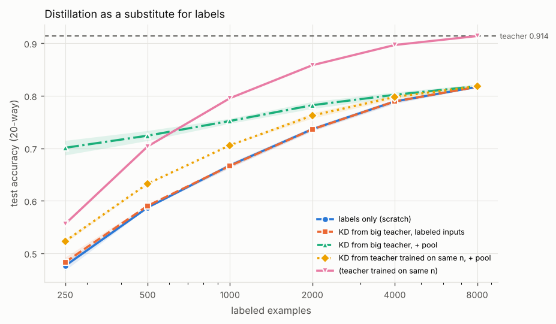

table

| method | n_labels | acc | target_ap | fidelity | nll | ece | kl_bayes | params | macs |
|---|---|---|---|---|---|---|---|---|---|
| labels only (scratch) | 250 | 0.4762 ± 0.009 | 0.6399 ± 0.087 | 0.4846 ± 0.012 | 3.7680 ± 0.082 | 0.3795 ± 0.005 | 3.6782 ± 0.085 | 2,132 | 2,048 |
| KD from big teacher, labeled inputs | 250 | 0.4831 ± 0.009 | 0.6488 ± 0.086 | 0.4914 ± 0.012 | 3.5615 ± 0.071 | 0.3676 ± 0.004 | 3.4738 ± 0.074 | 2,132 | 2,048 |
| KD from big teacher, + pool | 250 | 0.7010 ± 0.014 | 0.8828 ± 0.016 | 0.7142 ± 0.014 | 0.9032 ± 0.035 | 0.0126 ± 0.003 | 0.8216 ± 0.034 | 2,132 | 2,048 |
| KD from teacher trained on same n, + pool | 250 | 0.5233 ± 0.004 | 0.7061 ± 0.010 | 0.5346 ± 0.004 | 1.9103 ± 0.027 | 0.1805 ± 0.006 | 1.8195 ± 0.027 | 2,132 | 2,048 |
| (teacher trained on same n) | 250 | 0.5558 ± 0.000 | 0.7457 ± 0.000 |  | 2.0811 ± 0.000 | 0.2398 ± 0.000 | 1.9936 ± 0.000 | 140,052 | 139,264 |
| labels only (scratch) | 500 | 0.5872 ± 0.001 | 0.7503 ± 0.023 | 0.5947 ± 0.002 | 2.5581 ± 0.040 | 0.2926 ± 0.003 | 2.4796 ± 0.041 | 2,132 | 2,048 |
| KD from big teacher, labeled inputs | 500 | 0.5905 ± 0.002 | 0.7449 ± 0.031 | 0.5975 ± 0.003 | 2.5083 ± 0.025 | 0.2875 ± 0.002 | 2.4313 ± 0.025 | 2,132 | 2,048 |
| KD from big teacher, + pool | 500 | 0.7241 ± 0.010 | 0.8931 ± 0.009 | 0.7357 ± 0.010 | 0.8315 ± 0.022 | 0.0172 ± 0.001 | 0.7503 ± 0.023 | 2,132 | 2,048 |
| KD from teacher trained on same n, + pool | 500 | 0.6326 ± 0.001 | 0.7763 ± 0.012 | 0.6407 ± 0.001 | 1.1790 ± 0.004 | 0.0710 ± 0.002 | 1.0948 ± 0.005 | 2,132 | 2,048 |
| (teacher trained on same n) | 500 | 0.7035 ± 0.000 | 0.8304 ± 0.000 |  | 1.1042 ± 0.000 | 0.1352 ± 0.000 | 1.0226 ± 0.000 | 140,052 | 139,264 |
| labels only (scratch) | 1000 | 0.6675 ± 0.004 | 0.8527 ± 0.014 | 0.6753 ± 0.006 | 1.8047 ± 0.034 | 0.2192 ± 0.004 | 1.7205 ± 0.031 | 2,132 | 2,048 |
| KD from big teacher, labeled inputs | 1000 | 0.6666 ± 0.004 | 0.8540 ± 0.013 | 0.6748 ± 0.005 | 1.7952 ± 0.038 | 0.2187 ± 0.004 | 1.7107 ± 0.035 | 2,132 | 2,048 |
| KD from big teacher, + pool | 1000 | 0.7521 ± 0.005 | 0.9170 ± 0.006 | 0.7649 ± 0.007 | 0.7439 ± 0.014 | 0.0141 ± 0.002 | 0.6631 ± 0.015 | 2,132 | 2,048 |
| KD from teacher trained on same n, + pool | 1000 | 0.7058 ± 0.000 | 0.8831 ± 0.008 | 0.7153 ± 0.001 | 0.9230 ± 0.003 | 0.0317 ± 0.003 | 0.8411 ± 0.001 | 2,132 | 2,048 |
| (teacher trained on same n) | 1000 | 0.7955 ± 0.000 | 0.9446 ± 0.000 |  | 0.7743 ± 0.000 | 0.0896 ± 0.000 | 0.6977 ± 0.000 | 140,052 | 139,264 |
| labels only (scratch) | 2000 | 0.7365 ± 0.004 | 0.9068 ± 0.007 | 0.7483 ± 0.002 | 0.9867 ± 0.024 | 0.1203 ± 0.005 | 0.9066 ± 0.021 | 2,132 | 2,048 |
| KD from big teacher, labeled inputs | 2000 | 0.7362 ± 0.003 | 0.9089 ± 0.007 | 0.7477 ± 0.001 | 0.9880 ± 0.025 | 0.1202 ± 0.005 | 0.9074 ± 0.024 | 2,132 | 2,048 |
| KD from big teacher, + pool | 2000 | 0.7821 ± 0.007 | 0.9385 ± 0.005 | 0.7947 ± 0.007 | 0.6616 ± 0.020 | 0.0160 ± 0.002 | 0.5821 ± 0.019 | 2,132 | 2,048 |
| KD from teacher trained on same n, + pool | 2000 | 0.7624 ± 0.005 | 0.9272 ± 0.004 | 0.7744 ± 0.006 | 0.7180 ± 0.014 | 0.0116 ± 0.002 | 0.6371 ± 0.013 | 2,132 | 2,048 |
| (teacher trained on same n) | 2000 | 0.8583 ± 0.000 | 0.9728 ± 0.000 |  | 0.5202 ± 0.000 | 0.0640 ± 0.000 | 0.4500 ± 0.000 | 140,052 | 139,264 |
| labels only (scratch) | 4000 | 0.7893 ± 0.004 | 0.9344 ± 0.010 | 0.8008 ± 0.004 | 0.6642 ± 0.010 | 0.0397 ± 0.004 | 0.5853 ± 0.009 | 2,132 | 2,048 |
| KD from big teacher, labeled inputs | 4000 | 0.7893 ± 0.003 | 0.9349 ± 0.010 | 0.8006 ± 0.003 | 0.6629 ± 0.008 | 0.0397 ± 0.004 | 0.5842 ± 0.007 | 2,132 | 2,048 |
| KD from big teacher, + pool | 4000 | 0.8019 ± 0.005 | 0.9433 ± 0.010 | 0.8148 ± 0.006 | 0.6030 ± 0.014 | 0.0167 ± 0.003 | 0.5233 ± 0.015 | 2,132 | 2,048 |
| KD from teacher trained on same n, + pool | 4000 | 0.7979 ± 0.004 | 0.9428 ± 0.010 | 0.8095 ± 0.004 | 0.6163 ± 0.010 | 0.0134 ± 0.002 | 0.5367 ± 0.011 | 2,132 | 2,048 |
| (teacher trained on same n) | 4000 | 0.8968 ± 0.000 | 0.9839 ± 0.000 |  | 0.4021 ± 0.000 | 0.0557 ± 0.000 | 0.3302 ± 0.000 | 140,052 | 139,264 |
| labels only (scratch) | 8000 | 0.8170 ± 0.001 | 0.9524 ± 0.005 | 0.8309 ± 0.003 | 0.5538 ± 0.008 | 0.0092 ± 0.001 | 0.4758 ± 0.008 | 2,132 | 2,048 |
| KD from big teacher, labeled inputs | 8000 | 0.8171 ± 0.001 | 0.9518 ± 0.005 | 0.8312 ± 0.003 | 0.5536 ± 0.009 | 0.0105 ± 0.001 | 0.4754 ± 0.009 | 2,132 | 2,048 |
| KD from big teacher, + pool | 8000 | 0.8183 ± 0.003 | 0.9470 ± 0.008 | 0.8299 ± 0.005 | 0.5538 ± 0.013 | 0.0197 ± 0.003 | 0.4753 ± 0.014 | 2,132 | 2,048 |
| KD from teacher trained on same n, + pool | 8000 | 0.8183 ± 0.003 | 0.9470 ± 0.008 | 0.8299 ± 0.005 | 0.5538 ± 0.013 | 0.0197 ± 0.003 | 0.4753 ± 0.014 | 2,132 | 2,048 |
| (teacher trained on same n) | 8000 | 0.9139 ± 0.000 | 0.9885 ± 0.000 |  | 0.3843 ± 0.000 | 0.0554 ± 0.000 | 0.3093 ± 0.000 | 140,052 | 139,264 |

197s

### Distilling through label noise  (`label_noise`)

*When the labels are noisy, is a teacher trained on those same noisy labels still a better target than the labels themselves?*

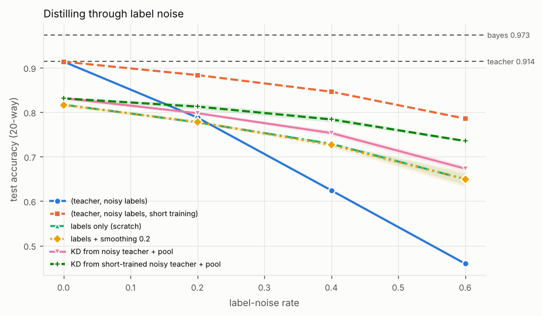

table

| method | noise | acc | target_ap | fidelity | nll | ece | kl_bayes | params | macs |
|---|---|---|---|---|---|---|---|---|---|
| (teacher, noisy labels) | 0.0000 | 0.9139 | 0.9885 |  | 0.3843 | 0.0554 | 0.3093 | 140,052 | 139,264 |
| (teacher, noisy labels, short training) | 0.0000 | 0.9137 | 0.9889 |  | 0.2648 | 0.0117 | 0.1858 | 140,052 | 139,264 |
| labels only (scratch) | 0.0000 | 0.8170 ± 0.001 | 0.9524 ± 0.005 | 0.8309 ± 0.003 | 0.5538 ± 0.008 | 0.0092 ± 0.001 | 0.4758 ± 0.008 | 2,132 | 2,048 |
| labels + smoothing 0.2 | 0.0000 | 0.8165 ± 0.004 | 0.9497 ± 0.002 | 0.8246 ± 0.005 | 0.8242 ± 0.013 | 0.2560 ± 0.002 | 0.7419 ± 0.013 | 2,132 | 2,048 |
| KD from noisy teacher + pool | 0.0000 | 0.8318 ± 0.005 | 0.9544 ± 0.005 | 0.8454 ± 0.005 | 0.5112 ± 0.013 | 0.0131 ± 0.003 | 0.4329 ± 0.015 | 2,132 | 2,048 |
| KD from short-trained noisy teacher + pool | 0.0000 | 0.8311 ± 0.002 | 0.9571 ± 0.005 | 0.8452 ± 0.003 | 0.5095 ± 0.011 | 0.0186 ± 0.003 | 0.4307 ± 0.012 | 2,132 | 2,048 |
| (teacher, noisy labels) | 0.2000 | 0.7881 | 0.9037 |  | 0.8706 | 0.1006 | 0.7947 | 140,052 | 139,264 |
| (teacher, noisy labels, short training) | 0.2000 | 0.8835 | 0.9810 |  | 0.5641 | 0.1902 | 0.4822 | 140,052 | 139,264 |
| labels only (scratch) | 0.2000 | 0.7773 ± 0.002 | 0.9277 ± 0.008 | 0.7876 ± 0.003 | 0.8905 ± 0.013 | 0.2199 ± 0.007 | 0.8076 ± 0.013 | 2,132 | 2,048 |
| labels + smoothing 0.2 | 0.2000 | 0.7781 ± 0.004 | 0.9218 ± 0.010 | 0.7878 ± 0.005 | 1.1280 ± 0.013 | 0.3534 ± 0.003 | 1.0442 ± 0.014 | 2,132 | 2,048 |
| KD from noisy teacher + pool | 0.2000 | 0.7978 ± 0.002 | 0.9383 ± 0.010 | 0.8078 ± 0.002 | 0.7785 ± 0.004 | 0.1859 ± 0.002 | 0.6955 ± 0.005 | 2,132 | 2,048 |
| KD from short-trained noisy teacher + pool | 0.2000 | 0.8127 ± 0.006 | 0.9475 ± 0.009 | 0.8240 ± 0.006 | 0.8065 ± 0.009 | 0.2325 ± 0.005 | 0.7237 ± 0.010 | 2,132 | 2,048 |
| (teacher, noisy labels) | 0.4000 | 0.6243 | 0.7595 |  | 1.6529 | 0.1882 | 1.5691 | 140,052 | 139,264 |
| (teacher, noisy labels, short training) | 0.4000 | 0.8462 | 0.9574 |  | 0.9054 | 0.3321 | 0.8212 | 140,052 | 139,264 |
| labels only (scratch) | 0.4000 | 0.7290 ± 0.002 | 0.9027 ± 0.012 | 0.7362 ± 0.001 | 1.2866 ± 0.004 | 0.3468 ± 0.006 | 1.2027 ± 0.005 | 2,132 | 2,048 |
| labels + smoothing 0.2 | 0.4000 | 0.7264 ± 0.005 | 0.8931 ± 0.020 | 0.7342 ± 0.004 | 1.4808 ± 0.004 | 0.4232 ± 0.008 | 1.3967 ± 0.005 | 2,132 | 2,048 |
| KD from noisy teacher + pool | 0.4000 | 0.7533 ± 0.006 | 0.9147 ± 0.015 | 0.7611 ± 0.006 | 1.1346 ± 0.011 | 0.3133 ± 0.004 | 1.0508 ± 0.012 | 2,132 | 2,048 |
| KD from short-trained noisy teacher + pool | 0.4000 | 0.7838 ± 0.006 | 0.9207 ± 0.008 | 0.7919 ± 0.005 | 1.1530 ± 0.007 | 0.3697 ± 0.006 | 1.0697 ± 0.007 | 2,132 | 2,048 |
| (teacher, noisy labels) | 0.6000 | 0.4594 | 0.4830 |  | 2.6238 | 0.2904 | 2.5438 | 140,052 | 139,264 |
| (teacher, noisy labels, short training) | 0.6000 | 0.7857 | 0.8933 |  | 1.2973 | 0.4252 | 1.2152 | 140,052 | 139,264 |
| labels only (scratch) | 0.6000 | 0.6494 ± 0.012 | 0.8435 ± 0.016 | 0.6582 ± 0.012 | 1.6977 ± 0.020 | 0.3947 ± 0.009 | 1.6140 ± 0.021 | 2,132 | 2,048 |
| labels + smoothing 0.2 | 0.6000 | 0.6495 ± 0.017 | 0.8367 ± 0.032 | 0.6577 ± 0.015 | 1.8602 ± 0.028 | 0.4419 ± 0.014 | 1.7759 ± 0.028 | 2,132 | 2,048 |
| KD from noisy teacher + pool | 0.6000 | 0.6732 ± 0.007 | 0.8965 ± 0.016 | 0.6817 ± 0.008 | 1.5404 ± 0.019 | 0.3699 ± 0.003 | 1.4571 ± 0.019 | 2,132 | 2,048 |
| KD from short-trained noisy teacher + pool | 0.6000 | 0.7353 ± 0.002 | 0.8951 ± 0.009 | 0.7444 ± 0.003 | 1.5250 ± 0.006 | 0.4498 ± 0.002 | 1.4418 ± 0.007 | 2,132 | 2,048 |

114s

### The distillation-loss zoo  (`loss_zoo`)

*Same student, same teacher, same inputs: which *form* of teacher signal transfers the most? (logits, probabilities, top-k only, hard labels, hidden features, relational structure)*

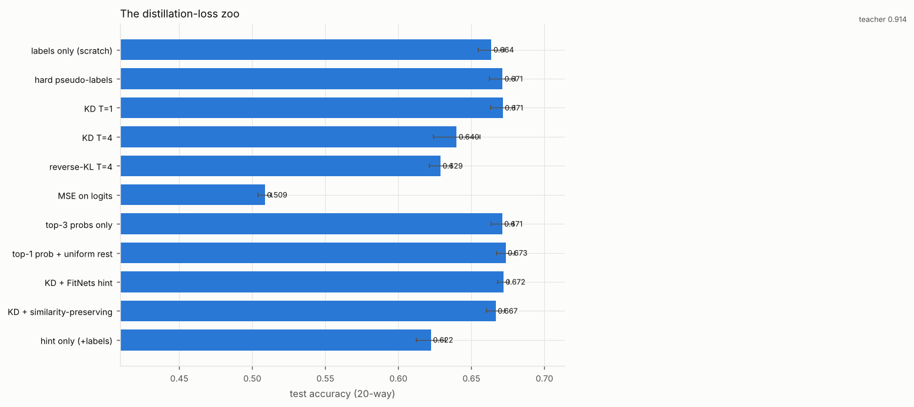

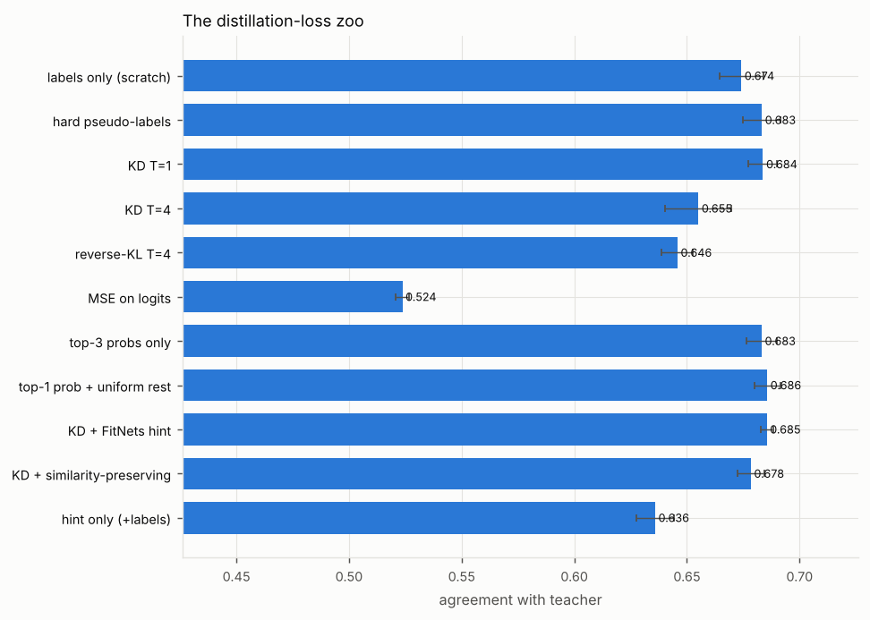

table

| method | acc | target_ap | fidelity | nll | ece | kl_bayes | params | macs |
|---|---|---|---|---|---|---|---|---|
| labels only (scratch) | 0.6637 ± 0.009 | 0.8432 ± 0.005 | 0.6741 ± 0.010 | 1.0180 ± 0.027 | 0.0146 ± 0.001 | 0.9359 ± 0.028 | 820 | 768 |
| hard pseudo-labels | 0.6712 ± 0.009 | 0.8629 ± 0.003 | 0.6832 ± 0.008 | 0.9925 ± 0.024 | 0.0190 ± 0.007 | 0.9112 ± 0.024 | 820 | 768 |
| KD T=1 | 0.6714 ± 0.008 | 0.8619 ± 0.002 | 0.6838 ± 0.006 | 0.9909 ± 0.023 | 0.0190 ± 0.009 | 0.9093 ± 0.023 | 820 | 768 |
| KD T=4 | 0.6398 ± 0.016 | 0.8455 ± 0.009 | 0.6551 ± 0.015 | 1.8185 ± 0.108 | 0.2411 ± 0.015 | 1.7335 ± 0.108 | 820 | 768 |
| reverse-KL T=4 | 0.6288 ± 0.007 | 0.8182 ± 0.018 | 0.6458 ± 0.007 | 3.4385 ± 0.105 | 0.2993 ± 0.006 | 3.3486 ± 0.111 | 820 | 768 |
| MSE on logits | 0.5086 ± 0.005 | 0.7738 ± 0.009 | 0.5237 ± 0.003 | 2.6093 ± 0.017 | 0.3472 ± 0.003 | 2.5189 ± 0.018 | 820 | 768 |
| top-3 probs only | 0.6710 ± 0.008 | 0.8628 ± 0.002 | 0.6832 ± 0.007 | 0.9897 ± 0.023 | 0.0176 ± 0.010 | 0.9081 ± 0.023 | 820 | 768 |
| top-1 prob + uniform rest | 0.6734 ± 0.006 | 0.8639 ± 0.007 | 0.6856 ± 0.006 | 0.9957 ± 0.020 | 0.0427 ± 0.009 | 0.9145 ± 0.020 | 820 | 768 |
| KD + FitNets hint | 0.6719 ± 0.004 | 0.8682 ± 0.011 | 0.6854 ± 0.003 | 0.9895 ± 0.024 | 0.0196 ± 0.006 | 0.9079 ± 0.025 | 820 | 768 |
| KD + similarity-preserving | 0.6666 ± 0.006 | 0.8646 ± 0.010 | 0.6784 ± 0.006 | 0.9984 ± 0.027 | 0.0171 ± 0.003 | 0.9156 ± 0.029 | 820 | 768 |
| hint only (+labels) | 0.6223 ± 0.010 | 0.8305 ± 0.003 | 0.6359 ± 0.008 | 1.1280 ± 0.038 | 0.0201 ± 0.002 | 1.0453 ± 0.039 | 820 | 768 |

99s

### KD across the student-size ladder  (`size_ladder`)

*How much does distillation help at each student size, and how much of that comes from the teacher's soft labels vs. from extra unlabeled inputs?*

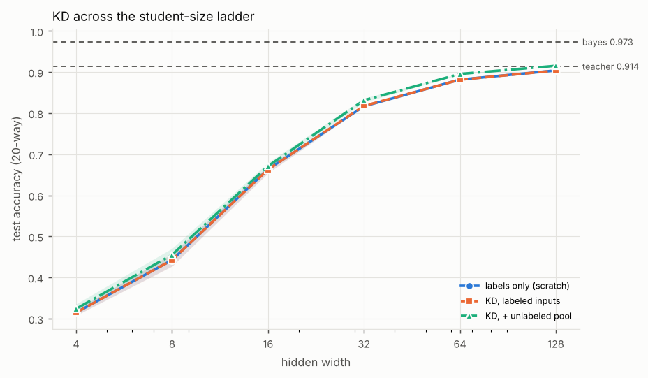

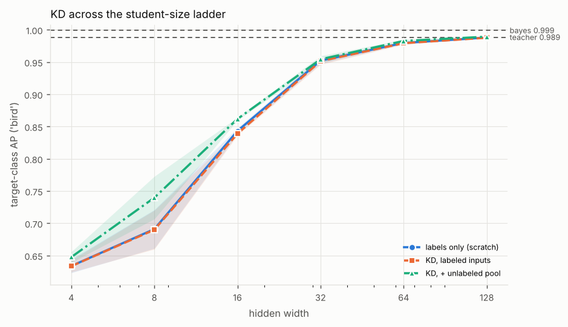

table

| method | width | acc | target_ap | fidelity | nll | ece | kl_bayes | params | macs |
|---|---|---|---|---|---|---|---|---|---|
| labels only (scratch) | 4 | 0.3149 ± 0.007 | 0.6337 ± 0.011 | 0.3198 ± 0.006 | 2.0162 ± 0.029 | 0.0215 ± 0.003 | 1.9313 ± 0.029 | 172 | 144 |
| KD, labeled inputs | 4 | 0.3148 ± 0.007 | 0.6335 ± 0.009 | 0.3195 ± 0.007 | 2.0160 ± 0.029 | 0.0214 ± 0.003 | 1.9311 ± 0.029 | 172 | 144 |
| KD, + unlabeled pool | 4 | 0.3240 ± 0.012 | 0.6475 ± 0.008 | 0.3288 ± 0.010 | 1.9887 ± 0.040 | 0.0219 ± 0.007 | 1.9041 ± 0.040 | 172 | 144 |
| labels only (scratch) | 8 | 0.4428 ± 0.015 | 0.6910 ± 0.030 | 0.4502 ± 0.016 | 1.6336 ± 0.027 | 0.0177 ± 0.001 | 1.5497 ± 0.027 | 356 | 320 |
| KD, labeled inputs | 8 | 0.4428 ± 0.015 | 0.6900 ± 0.030 | 0.4500 ± 0.016 | 1.6337 ± 0.027 | 0.0175 ± 0.001 | 1.5499 ± 0.028 | 356 | 320 |
| KD, + unlabeled pool | 8 | 0.4556 ± 0.015 | 0.7397 ± 0.033 | 0.4642 ± 0.018 | 1.6033 ± 0.028 | 0.0156 ± 0.004 | 1.5192 ± 0.029 | 356 | 320 |
| labels only (scratch) | 16 | 0.6637 ± 0.009 | 0.8432 ± 0.005 | 0.6741 ± 0.010 | 1.0180 ± 0.027 | 0.0146 ± 0.001 | 0.9359 ± 0.028 | 820 | 768 |
| KD, labeled inputs | 16 | 0.6631 ± 0.009 | 0.8390 ± 0.003 | 0.6732 ± 0.010 | 1.0176 ± 0.027 | 0.0123 ± 0.002 | 0.9358 ± 0.028 | 820 | 768 |
| KD, + unlabeled pool | 16 | 0.6714 ± 0.008 | 0.8619 ± 0.002 | 0.6838 ± 0.006 | 0.9909 ± 0.023 | 0.0190 ± 0.009 | 0.9093 ± 0.023 | 820 | 768 |
| labels only (scratch) | 32 | 0.8170 ± 0.001 | 0.9524 ± 0.005 | 0.8309 ± 0.003 | 0.5538 ± 0.008 | 0.0092 ± 0.001 | 0.4758 ± 0.008 | 2,132 | 2,048 |
| KD, labeled inputs | 32 | 0.8180 ± 0.000 | 0.9515 ± 0.005 | 0.8327 ± 0.002 | 0.5532 ± 0.008 | 0.0100 ± 0.002 | 0.4752 ± 0.008 | 2,132 | 2,048 |
| KD, + unlabeled pool | 32 | 0.8318 ± 0.005 | 0.9544 ± 0.005 | 0.8454 ± 0.005 | 0.5112 ± 0.013 | 0.0131 ± 0.003 | 0.4329 ± 0.015 | 2,132 | 2,048 |
| labels only (scratch) | 64 | 0.8820 ± 0.001 | 0.9797 ± 0.002 | 0.9011 ± 0.002 | 0.3626 ± 0.003 | 0.0245 ± 0.002 | 0.2857 ± 0.001 | 6,292 | 6,144 |
| KD, labeled inputs | 64 | 0.8817 ± 0.001 | 0.9793 ± 0.002 | 0.9006 ± 0.003 | 0.3613 ± 0.002 | 0.0246 ± 0.002 | 0.2842 ± 0.000 | 6,292 | 6,144 |
| KD, + unlabeled pool | 64 | 0.8957 ± 0.001 | 0.9829 ± 0.002 | 0.9160 ± 0.001 | 0.3164 ± 0.003 | 0.0078 ± 0.002 | 0.2380 ± 0.002 | 6,292 | 6,144 |
| labels only (scratch) | 128 | 0.9042 ± 0.002 | 0.9881 ± 0.001 | 0.9315 ± 0.001 | 0.3281 ± 0.008 | 0.0392 ± 0.001 | 0.2552 ± 0.010 | 20,756 | 20,480 |
| KD, labeled inputs | 128 | 0.9040 ± 0.002 | 0.9878 ± 0.001 | 0.9312 ± 0.003 | 0.3283 ± 0.008 | 0.0397 ± 0.002 | 0.2547 ± 0.011 | 20,756 | 20,480 |
| KD, + unlabeled pool | 128 | 0.9156 ± 0.000 | 0.9894 ± 0.000 | 0.9471 ± 0.001 | 0.2673 ± 0.002 | 0.0208 ± 0.001 | 0.1900 ± 0.001 | 20,756 | 20,480 |

157s

### Temperature x KD-weight grid  (`temperature_alpha`)

*Which temperature T and what mix of KD vs. ground-truth CE (alpha) works best when the student only sees the labeled set?*

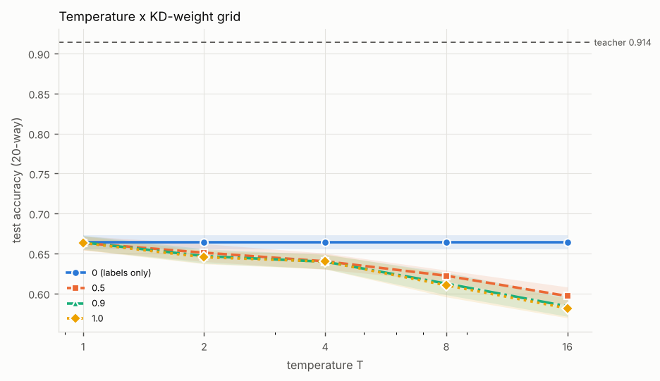

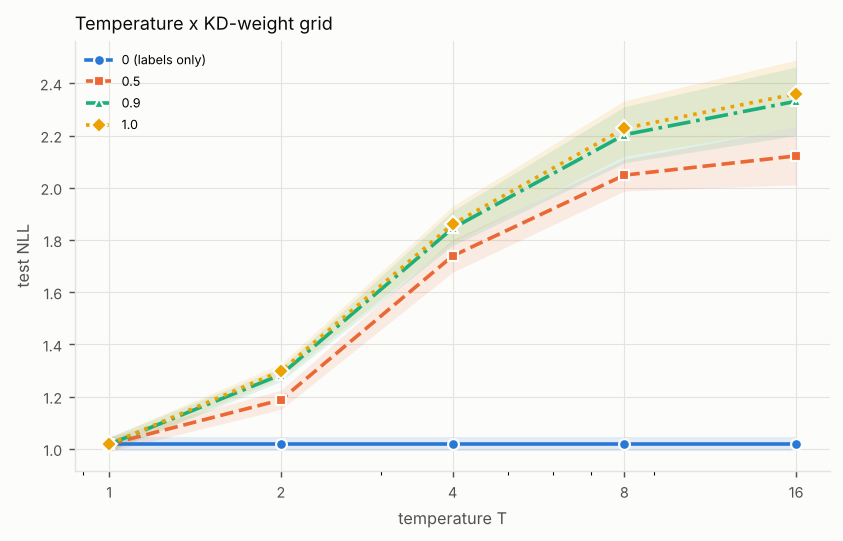

table

| alpha | T | acc | target_ap | fidelity | nll | ece | kl_bayes | params | macs |
|---|---|---|---|---|---|---|---|---|---|
| 0 (labels only) | 1 | 0.6637 ± 0.009 | 0.8432 ± 0.005 | 0.6741 ± 0.010 | 1.0180 ± 0.027 | 0.0146 ± 0.001 | 0.9359 ± 0.028 | 820 | 768 |
| 0.5 | 1 | 0.6631 ± 0.009 | 0.8443 ± 0.005 | 0.6740 ± 0.010 | 1.0178 ± 0.028 | 0.0144 ± 0.001 | 0.9357 ± 0.029 | 820 | 768 |
| 0.9 | 1 | 0.6639 ± 0.009 | 0.8391 ± 0.003 | 0.6746 ± 0.010 | 1.0174 ± 0.027 | 0.0140 ± 0.001 | 0.9356 ± 0.028 | 820 | 768 |
| 1.0 | 1 | 0.6631 ± 0.009 | 0.8390 ± 0.003 | 0.6732 ± 0.010 | 1.0176 ± 0.027 | 0.0123 ± 0.002 | 0.9358 ± 0.028 | 820 | 768 |
| 0 (labels only) | 2 | 0.6637 ± 0.009 | 0.8432 ± 0.005 | 0.6741 ± 0.010 | 1.0180 ± 0.027 | 0.0146 ± 0.001 | 0.9359 ± 0.028 | 820 | 768 |
| 0.5 | 2 | 0.6510 ± 0.011 | 0.8408 ± 0.007 | 0.6629 ± 0.011 | 1.1876 ± 0.037 | 0.1301 ± 0.006 | 1.1047 ± 0.040 | 820 | 768 |
| 0.9 | 2 | 0.6468 ± 0.009 | 0.8391 ± 0.012 | 0.6576 ± 0.010 | 1.2840 ± 0.026 | 0.1594 ± 0.004 | 1.2009 ± 0.028 | 820 | 768 |
| 1.0 | 2 | 0.6453 ± 0.008 | 0.8394 ± 0.011 | 0.6565 ± 0.010 | 1.2980 ± 0.027 | 0.1646 ± 0.004 | 1.2152 ± 0.029 | 820 | 768 |
| 0 (labels only) | 4 | 0.6637 ± 0.009 | 0.8432 ± 0.005 | 0.6741 ± 0.010 | 1.0180 ± 0.027 | 0.0146 ± 0.001 | 0.9359 ± 0.028 | 820 | 768 |
| 0.5 | 4 | 0.6403 ± 0.010 | 0.8448 ± 0.010 | 0.6520 ± 0.009 | 1.7388 ± 0.062 | 0.2305 ± 0.009 | 1.6583 ± 0.061 | 820 | 768 |
| 0.9 | 4 | 0.6397 ± 0.009 | 0.8425 ± 0.012 | 0.6516 ± 0.008 | 1.8450 ± 0.067 | 0.2406 ± 0.008 | 1.7646 ± 0.068 | 820 | 768 |
| 1.0 | 4 | 0.6399 ± 0.009 | 0.8432 ± 0.013 | 0.6511 ± 0.008 | 1.8606 ± 0.069 | 0.2414 ± 0.009 | 1.7804 ± 0.070 | 820 | 768 |
| 0 (labels only) | 8 | 0.6637 ± 0.009 | 0.8432 ± 0.005 | 0.6741 ± 0.010 | 1.0180 ± 0.027 | 0.0146 ± 0.001 | 0.9359 ± 0.028 | 820 | 768 |
| 0.5 | 8 | 0.6222 ± 0.007 | 0.8303 ± 0.026 | 0.6371 ± 0.006 | 2.0483 ± 0.061 | 0.2652 ± 0.004 | 1.9623 ± 0.063 | 820 | 768 |
| 0.9 | 8 | 0.6124 ± 0.014 | 0.8245 ± 0.024 | 0.6284 ± 0.013 | 2.2030 ± 0.107 | 0.2797 ± 0.011 | 2.1137 ± 0.109 | 820 | 768 |
| 1.0 | 8 | 0.6102 ± 0.015 | 0.8242 ± 0.022 | 0.6265 ± 0.014 | 2.2272 ± 0.106 | 0.2830 ± 0.012 | 2.1379 ± 0.108 | 820 | 768 |
| 0 (labels only) | 16 | 0.6637 ± 0.009 | 0.8432 ± 0.005 | 0.6741 ± 0.010 | 1.0180 ± 0.027 | 0.0146 ± 0.001 | 0.9359 ± 0.028 | 820 | 768 |
| 0.5 | 16 | 0.5968 ± 0.011 | 0.8151 ± 0.031 | 0.6143 ± 0.013 | 2.1219 ± 0.111 | 0.2811 ± 0.010 | 2.0334 ± 0.115 | 820 | 768 |
| 0.9 | 16 | 0.5840 ± 0.013 | 0.8106 ± 0.026 | 0.6008 ± 0.013 | 2.3313 ± 0.131 | 0.2998 ± 0.011 | 2.2392 ± 0.136 | 820 | 768 |
| 1.0 | 16 | 0.5815 ± 0.012 | 0.8111 ± 0.024 | 0.5976 ± 0.012 | 2.3598 ± 0.129 | 0.3030 ± 0.010 | 2.2675 ± 0.134 | 820 | 768 |

112s

## 2 · Teacher edge cases

### A systematically wrong teacher  (`biased_teacher`)

*The teacher learned a bias: half its 'bird' training labels said 'sibling'. KD copies the bias faithfully -- can mixing in clean labels undo it?*

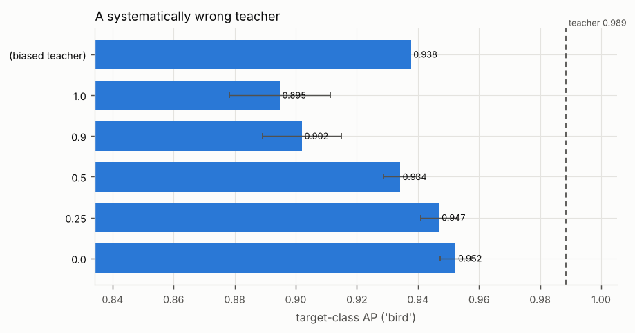

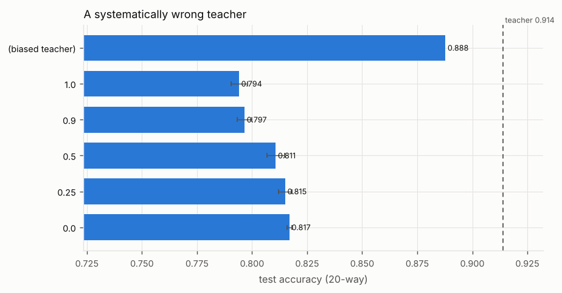

table

| alpha | acc | target_ap | nll | ece | kl_bayes | params | macs |
|---|---|---|---|---|---|---|---|
| (biased teacher) | 0.8878 | 0.9377 | 0.4988 | 0.0745 | 0.4293 | 140,052 | 139,264 |
| 1.0 | 0.7941 ± 0.004 | 0.8948 ± 0.016 | 0.6000 ± 0.010 | 0.0121 ± 0.000 | 0.5207 ± 0.012 | 2,132 | 2,048 |
| 0.9 | 0.7966 ± 0.003 | 0.9020 ± 0.013 | 0.5958 ± 0.009 | 0.0130 ± 0.000 | 0.5165 ± 0.010 | 2,132 | 2,048 |
| 0.5 | 0.8108 ± 0.004 | 0.9342 ± 0.005 | 0.5741 ± 0.010 | 0.0087 ± 0.001 | 0.4942 ± 0.011 | 2,132 | 2,048 |
| 0.25 | 0.8151 ± 0.003 | 0.9470 ± 0.006 | 0.5611 ± 0.008 | 0.0093 ± 0.001 | 0.4811 ± 0.009 | 2,132 | 2,048 |
| 0.0 | 0.8170 ± 0.001 | 0.9524 ± 0.005 | 0.5538 ± 0.008 | 0.0092 ± 0.001 | 0.4758 ± 0.008 | 2,132 | 2,048 |

36s

### Born-again networks (self-distillation)  (`born_again`)

*Can a model teach a copy of *itself* to be better? Repeat for several generations, small and big.*

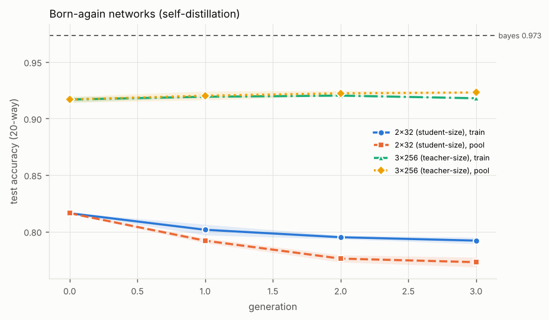

table

| generation | arch | transfer | acc | target_ap | fidelity | nll | ece | kl_bayes | params | macs |
|---|---|---|---|---|---|---|---|---|---|---|
| 0 | 2x32 (student-size) | train | 0.8163 ± 0.001 | 0.9489 ± 0.001 |  | 0.5551 ± 0.009 | 0.0089 ± 0.001 | 0.4780 ± 0.009 | 2,132 | 2,048 |
| 1 | 2x32 (student-size) | train | 0.8016 ± 0.005 | 0.9368 ± 0.007 | 0.8194 ± 0.003 | 0.5946 ± 0.011 | 0.0168 ± 0.001 | 0.5144 ± 0.009 | 2,132 | 2,048 |
| 2 | 2x32 (student-size) | train | 0.7951 ± 0.002 | 0.9375 ± 0.001 | 0.8383 ± 0.003 | 0.6193 ± 0.010 | 0.0269 ± 0.004 | 0.5378 ± 0.008 | 2,132 | 2,048 |
| 3 | 2x32 (student-size) | train | 0.7921 ± 0.003 | 0.9393 ± 0.005 | 0.8481 ± 0.003 | 0.6280 ± 0.001 | 0.0396 ± 0.006 | 0.5475 ± 0.001 | 2,132 | 2,048 |
| 0 | 2x32 (student-size) | pool | 0.8163 ± 0.001 | 0.9489 ± 0.001 |  | 0.5551 ± 0.009 | 0.0089 ± 0.001 | 0.4780 ± 0.009 | 2,132 | 2,048 |
| 1 | 2x32 (student-size) | pool | 0.7920 ± 0.002 | 0.9315 ± 0.000 | 0.8178 ± 0.000 | 0.6196 ± 0.003 | 0.0162 ± 0.002 | 0.5390 ± 0.002 | 2,132 | 2,048 |
| 2 | 2x32 (student-size) | pool | 0.7762 ± 0.003 | 0.9213 ± 0.005 | 0.8293 ± 0.003 | 0.6717 ± 0.012 | 0.0252 ± 0.001 | 0.5894 ± 0.010 | 2,132 | 2,048 |
| 3 | 2x32 (student-size) | pool | 0.7730 ± 0.004 | 0.9222 ± 0.005 | 0.8415 ± 0.005 | 0.6866 ± 0.001 | 0.0395 ± 0.007 | 0.6054 ± 0.002 | 2,132 | 2,048 |
| 0 | 3x256 (teacher-size) | train | 0.9168 ± 0.003 | 0.9895 ± 0.001 |  | 0.3735 ± 0.016 | 0.0533 ± 0.003 | 0.3025 ± 0.013 | 140,052 | 139,264 |
| 1 | 3x256 (teacher-size) | train | 0.9193 ± 0.001 | 0.9907 ± 0.001 | 0.9503 ± 0.002 | 0.3668 ± 0.000 | 0.0515 ± 0.001 | 0.2971 ± 0.001 | 140,052 | 139,264 |
| 2 | 3x256 (teacher-size) | train | 0.9203 ± 0.001 | 0.9901 ± 0.001 | 0.9529 ± 0.000 | 0.3641 ± 0.001 | 0.0511 ± 0.000 | 0.2972 ± 0.000 | 140,052 | 139,264 |
| 3 | 3x256 (teacher-size) | train | 0.9180 ± 0.000 | 0.9880 ± 0.000 | 0.9551 ± 0.002 | 0.3697 ± 0.000 | 0.0529 ± 0.000 | 0.2985 ± 0.001 | 140,052 | 139,264 |
| 0 | 3x256 (teacher-size) | pool | 0.9168 ± 0.003 | 0.9895 ± 0.001 |  | 0.3735 ± 0.016 | 0.0533 ± 0.003 | 0.3025 ± 0.013 | 140,052 | 139,264 |
| 1 | 3x256 (teacher-size) | pool | 0.9203 ± 0.004 | 0.9901 ± 0.001 | 0.9603 ± 0.001 | 0.3402 ± 0.015 | 0.0496 ± 0.004 | 0.2672 ± 0.013 | 140,052 | 139,264 |
| 2 | 3x256 (teacher-size) | pool | 0.9224 ± 0.002 | 0.9900 ± 0.001 | 0.9667 ± 0.001 | 0.3248 ± 0.011 | 0.0468 ± 0.003 | 0.2502 ± 0.008 | 140,052 | 139,264 |
| 3 | 3x256 (teacher-size) | pool | 0.9231 ± 0.001 | 0.9905 ± 0.000 | 0.9654 ± 0.000 | 0.3184 ± 0.007 | 0.0455 ± 0.001 | 0.2446 ± 0.007 | 140,052 | 139,264 |

262s

### Capacity gap & teacher assistants  (`capacity_gap`)

*Does a bigger teacher always make a better student? When the gap is huge, does an intermediate 'teacher assistant' help?*

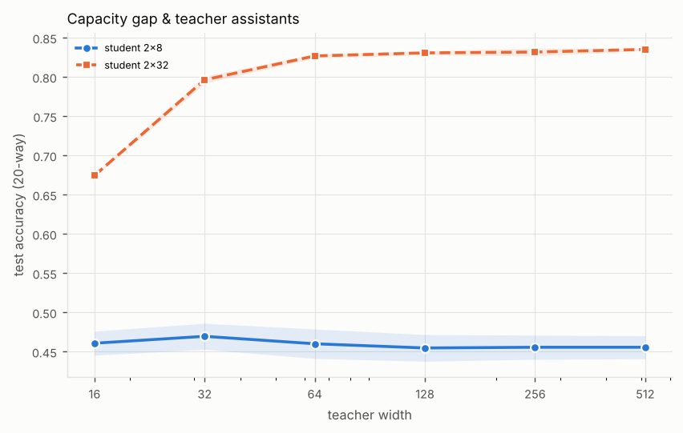

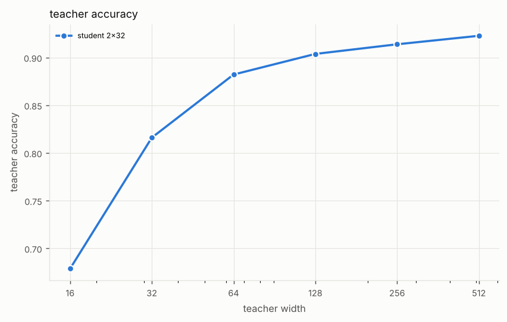

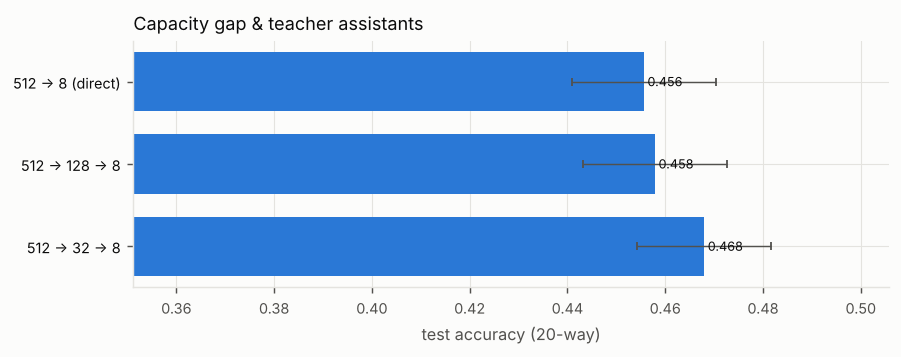

table

| student | teacher_width | path | acc | target_ap | nll | ece | kl_bayes | teacher_acc | params | macs |
|---|---|---|---|---|---|---|---|---|---|---|
| student 2x8 | 16 |  | 0.4608 ± 0.015 | 0.7085 ± 0.024 | 1.5909 ± 0.039 | 0.0230 ± 0.005 | 1.5063 ± 0.039 | 0.6788 ± 0.000 | 356 | 320 |
| student 2x32 | 16 |  | 0.6744 ± 0.002 | 0.8623 ± 0.005 | 0.9847 ± 0.002 | 0.0599 ± 0.002 | 0.9026 ± 0.003 | 0.6788 ± 0.000 | 2,132 | 2,048 |
| student 2x8 | 32 |  | 0.4696 ± 0.017 | 0.7297 ± 0.026 | 1.5637 ± 0.016 | 0.0214 ± 0.009 | 1.4795 ± 0.016 | 0.8161 ± 0.000 | 356 | 320 |
| student 2x32 | 32 |  | 0.7964 ± 0.005 | 0.9247 ± 0.010 | 0.6258 ± 0.006 | 0.0466 ± 0.007 | 0.5458 ± 0.006 | 0.8161 ± 0.000 | 2,132 | 2,048 |
| student 2x8 | 64 |  | 0.4601 ± 0.019 | 0.7382 ± 0.032 | 1.6006 ± 0.030 | 0.0192 ± 0.005 | 1.5171 ± 0.031 | 0.8822 ± 0.000 | 356 | 320 |
| student 2x32 | 64 |  | 0.8268 ± 0.003 | 0.9539 ± 0.006 | 0.5247 ± 0.008 | 0.0233 ± 0.003 | 0.4463 ± 0.009 | 0.8822 ± 0.000 | 2,132 | 2,048 |
| student 2x8 | 128 |  | 0.4547 ± 0.017 | 0.7384 ± 0.031 | 1.6022 ± 0.031 | 0.0161 ± 0.006 | 1.5181 ± 0.032 | 0.9038 ± 0.000 | 356 | 320 |
| student 2x32 | 128 |  | 0.8307 ± 0.003 | 0.9557 ± 0.007 | 0.5147 ± 0.008 | 0.0160 ± 0.001 | 0.4353 ± 0.008 | 0.9038 ± 0.000 | 2,132 | 2,048 |
| student 2x8 | 256 |  | 0.4556 ± 0.015 | 0.7397 ± 0.033 | 1.6033 ± 0.028 | 0.0156 ± 0.004 | 1.5192 ± 0.029 | 0.9139 ± 0.000 | 356 | 320 |
| student 2x32 | 256 |  | 0.8318 ± 0.005 | 0.9544 ± 0.005 | 0.5112 ± 0.013 | 0.0131 ± 0.003 | 0.4329 ± 0.015 | 0.9139 ± 0.000 | 2,132 | 2,048 |
| student 2x8 | 512 |  | 0.4556 ± 0.015 | 0.7390 ± 0.031 | 1.6085 ± 0.031 | 0.0163 ± 0.005 | 1.5245 ± 0.033 | 0.9228 ± 0.000 | 356 | 320 |
| student 2x32 | 512 |  | 0.8351 ± 0.001 | 0.9555 ± 0.005 | 0.5053 ± 0.008 | 0.0165 ± 0.002 | 0.4271 ± 0.009 | 0.9228 ± 0.000 | 2,132 | 2,048 |
| chain | 512.0 ± 0.000 | 512 -> 8 (direct) | 0.4556 ± 0.015 | 0.7390 ± 0.031 | 1.6085 ± 0.031 | 0.0163 ± 0.005 | 1.5245 ± 0.033 |  | 356 | 320 |
| chain | 512.0 ± 0.000 | 512 -> 128 -> 8 | 0.4579 ± 0.015 | 0.7385 ± 0.031 | 1.6007 ± 0.031 | 0.0174 ± 0.005 | 1.5168 ± 0.032 |  | 356 | 320 |
| chain | 512.0 ± 0.000 | 512 -> 32 -> 8 | 0.4680 ± 0.014 | 0.7277 ± 0.013 | 1.5734 ± 0.026 | 0.0192 ± 0.002 | 1.4891 ± 0.026 |  | 356 | 320 |

88s

### Ensembles as teachers  (`ensemble_teacher`)

*Is an ensemble of teachers a better target than one? Average logits or average probabilities?*

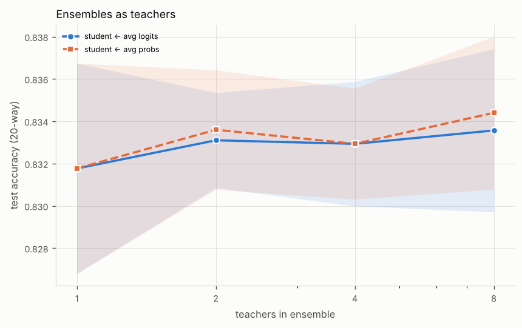

table

| method | n_teachers | acc | target_ap | nll | ece | kl_bayes | params | macs |
|---|---|---|---|---|---|---|---|---|
| student <- avg logits | 1 | 0.8318 ± 0.005 | 0.9544 ± 0.005 | 0.5112 ± 0.013 | 0.0131 ± 0.003 | 0.4329 ± 0.015 | 2,132 | 2,048 |
| student <- avg probs | 1 | 0.8318 ± 0.005 | 0.9544 ± 0.005 | 0.5112 ± 0.013 | 0.0131 ± 0.003 | 0.4329 ± 0.015 | 2,132 | 2,048 |
| (ensemble itself) | 1 | 0.9139 |  |  |  |  |  |  |
| student <- avg logits | 2 | 0.8331 ± 0.002 | 0.9555 ± 0.006 | 0.5082 ± 0.010 | 0.0133 ± 0.001 | 0.4299 ± 0.011 | 2,132 | 2,048 |
| student <- avg probs | 2 | 0.8336 ± 0.003 | 0.9556 ± 0.005 | 0.5072 ± 0.012 | 0.0136 ± 0.003 | 0.4288 ± 0.013 | 2,132 | 2,048 |
| (ensemble itself) | 2 | 0.9222 |  |  |  |  |  |  |
| student <- avg logits | 4 | 0.8329 ± 0.003 | 0.9551 ± 0.005 | 0.5052 ± 0.010 | 0.0128 ± 0.003 | 0.4272 ± 0.012 | 2,132 | 2,048 |
| student <- avg probs | 4 | 0.8329 ± 0.003 | 0.9554 ± 0.005 | 0.5061 ± 0.010 | 0.0138 ± 0.002 | 0.4282 ± 0.011 | 2,132 | 2,048 |
| (ensemble itself) | 4 | 0.9256 |  |  |  |  |  |  |
| student <- avg logits | 8 | 0.8336 ± 0.004 | 0.9558 ± 0.006 | 0.5036 ± 0.010 | 0.0112 ± 0.003 | 0.4258 ± 0.012 | 2,132 | 2,048 |
| student <- avg probs | 8 | 0.8344 ± 0.004 | 0.9564 ± 0.005 | 0.5031 ± 0.009 | 0.0138 ± 0.002 | 0.4255 ± 0.011 | 2,132 | 2,048 |
| (ensemble itself) | 8 | 0.9263 |  |  |  |  |  |  |

32s

### Students don't match their teachers  (`fidelity_gap`)

*Even a student big enough to copy the teacher exactly often doesn't. How does agreement with the teacher grow with capacity and training length?*

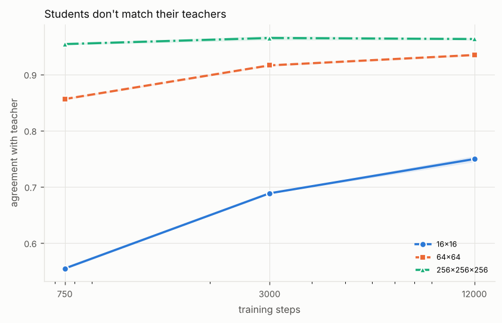

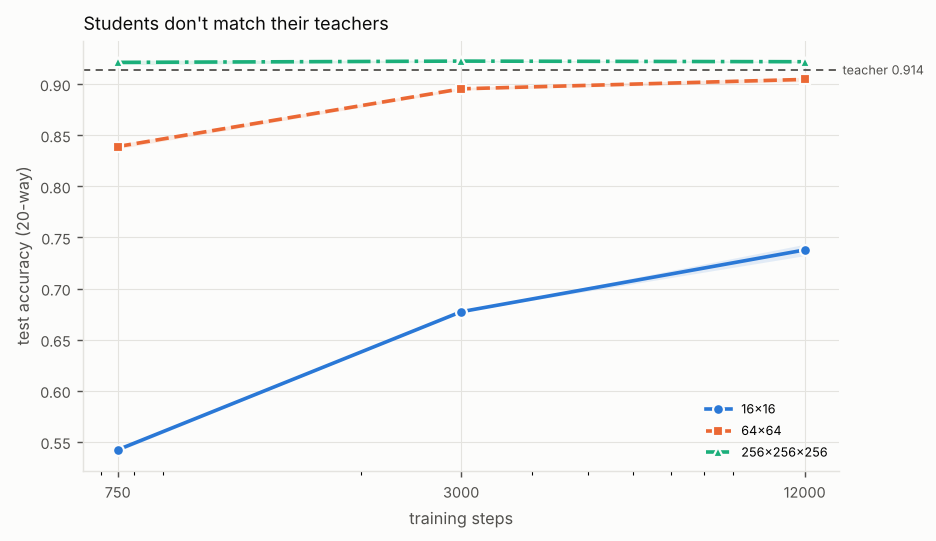

table

| student | steps | acc | target_ap | fidelity | nll | ece | kl_bayes | params | macs |
|---|---|---|---|---|---|---|---|---|---|
| 16x16 | 750 | 0.5423 ± 0.002 | 0.7764 ± 0.024 | 0.5544 ± 0.002 | 1.3462 ± 0.016 | 0.0322 ± 0.001 | 1.2632 ± 0.019 | 820 | 768 |
| 16x16 | 3000 | 0.6774 ± 0.000 | 0.8603 ± 0.000 | 0.6883 ± 0.001 | 0.9795 ± 0.019 | 0.0246 ± 0.006 | 0.8978 ± 0.019 | 820 | 768 |
| 16x16 | 12000 | 0.7377 ± 0.006 | 0.8929 ± 0.003 | 0.7493 ± 0.005 | 0.7973 ± 0.013 | 0.0158 ± 0.003 | 0.7165 ± 0.012 | 820 | 768 |
| 64x64 | 750 | 0.8389 ± 0.002 | 0.9597 ± 0.000 | 0.8560 ± 0.002 | 0.4944 ± 0.003 | 0.0449 ± 0.002 | 0.4131 ± 0.004 | 6,292 | 6,144 |
| 64x64 | 3000 | 0.8953 ± 0.001 | 0.9833 ± 0.003 | 0.9160 ± 0.002 | 0.3186 ± 0.001 | 0.0088 ± 0.001 | 0.2396 ± 0.000 | 6,292 | 6,144 |
| 64x64 | 12000 | 0.9045 ± 0.002 | 0.9853 ± 0.001 | 0.9345 ± 0.002 | 0.3330 ± 0.003 | 0.0385 ± 0.001 | 0.2552 ± 0.003 | 6,292 | 6,144 |
| 256x256x256 | 750 | 0.9212 ± 0.002 | 0.9903 ± 0.001 | 0.9539 ± 0.002 | 0.2457 ± 0.005 | 0.0186 ± 0.003 | 0.1690 ± 0.006 | 140,052 | 139,264 |
| 256x256x256 | 3000 | 0.9224 ± 0.001 | 0.9894 ± 0.000 | 0.9647 ± 0.004 | 0.2905 ± 0.002 | 0.0386 ± 0.002 | 0.2140 ± 0.002 | 140,052 | 139,264 |
| 256x256x256 | 12000 | 0.9219 ± 0.001 | 0.9901 ± 0.000 | 0.9628 ± 0.002 | 0.3012 ± 0.000 | 0.0412 ± 0.001 | 0.2246 ± 0.001 | 140,052 | 139,264 |

213s

### Distilling from the true posterior  (`oracle_teacher`)

*If the teacher's soft labels were *perfect* (the exact Bayes posterior), how much better would students get? This bounds what any teacher can give.*

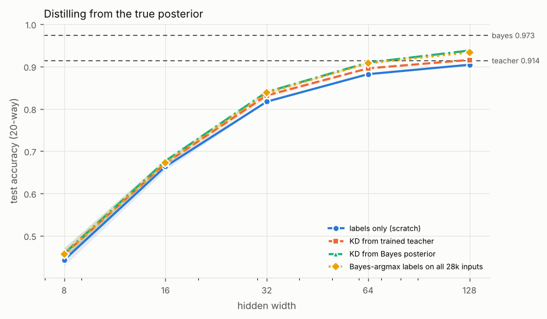

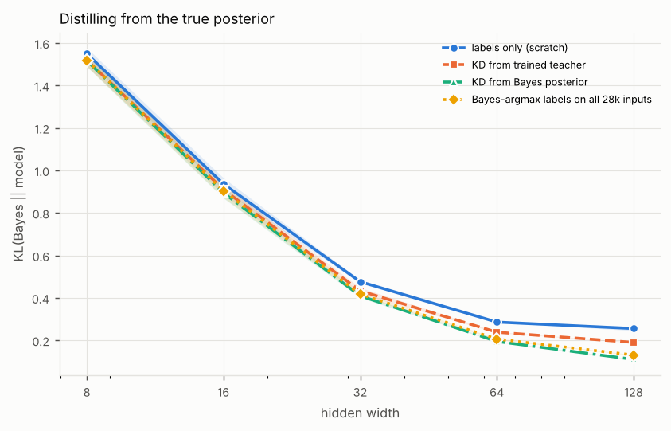

table

| method | width | acc | target_ap | fidelity | nll | ece | kl_bayes | params | macs |
|---|---|---|---|---|---|---|---|---|---|
| labels only (scratch) | 8 | 0.4428 ± 0.015 | 0.6910 ± 0.030 | 0.4502 ± 0.016 | 1.6336 ± 0.027 | 0.0177 ± 0.001 | 1.5497 ± 0.027 | 356 | 320 |
| KD from trained teacher | 8 | 0.4556 ± 0.015 | 0.7397 ± 0.033 | 0.4642 ± 0.018 | 1.6033 ± 0.028 | 0.0156 ± 0.004 | 1.5192 ± 0.029 | 356 | 320 |
| KD from Bayes posterior | 8 | 0.4577 ± 0.014 | 0.7392 ± 0.032 | 0.4652 ± 0.015 | 1.6012 ± 0.027 | 0.0178 ± 0.003 | 1.5171 ± 0.029 | 356 | 320 |
| Bayes-argmax labels on all 28k inputs | 8 | 0.4562 ± 0.013 | 0.7380 ± 0.031 | 0.4636 ± 0.015 | 1.6032 ± 0.026 | 0.0164 ± 0.004 | 1.5188 ± 0.027 | 356 | 320 |
| labels only (scratch) | 16 | 0.6637 ± 0.009 | 0.8432 ± 0.005 | 0.6741 ± 0.010 | 1.0180 ± 0.027 | 0.0146 ± 0.001 | 0.9359 ± 0.028 | 820 | 768 |
| KD from trained teacher | 16 | 0.6714 ± 0.008 | 0.8619 ± 0.002 | 0.6838 ± 0.006 | 0.9909 ± 0.023 | 0.0190 ± 0.009 | 0.9093 ± 0.023 | 820 | 768 |
| KD from Bayes posterior | 16 | 0.6766 ± 0.007 | 0.8629 ± 0.008 | 0.6853 ± 0.004 | 0.9765 ± 0.026 | 0.0254 ± 0.009 | 0.8944 ± 0.026 | 820 | 768 |
| Bayes-argmax labels on all 28k inputs | 16 | 0.6728 ± 0.007 | 0.8565 ± 0.008 | 0.6808 ± 0.007 | 0.9846 ± 0.032 | 0.0226 ± 0.007 | 0.9028 ± 0.031 | 820 | 768 |
| labels only (scratch) | 32 | 0.8170 ± 0.001 | 0.9524 ± 0.005 | 0.8309 ± 0.003 | 0.5538 ± 0.008 | 0.0092 ± 0.001 | 0.4758 ± 0.008 | 2,132 | 2,048 |
| KD from trained teacher | 32 | 0.8318 ± 0.005 | 0.9544 ± 0.005 | 0.8454 ± 0.005 | 0.5112 ± 0.013 | 0.0131 ± 0.003 | 0.4329 ± 0.015 | 2,132 | 2,048 |
| KD from Bayes posterior | 32 | 0.8399 ± 0.003 | 0.9593 ± 0.005 | 0.8447 ± 0.003 | 0.4878 ± 0.007 | 0.0202 ± 0.002 | 0.4092 ± 0.009 | 2,132 | 2,048 |
| Bayes-argmax labels on all 28k inputs | 32 | 0.8378 ± 0.002 | 0.9586 ± 0.006 | 0.8422 ± 0.003 | 0.4955 ± 0.008 | 0.0142 ± 0.002 | 0.4174 ± 0.010 | 2,132 | 2,048 |
| labels only (scratch) | 64 | 0.8820 ± 0.001 | 0.9797 ± 0.002 | 0.9011 ± 0.002 | 0.3626 ± 0.003 | 0.0245 ± 0.002 | 0.2857 ± 0.001 | 6,292 | 6,144 |
| KD from trained teacher | 64 | 0.8957 ± 0.001 | 0.9829 ± 0.002 | 0.9160 ± 0.001 | 0.3164 ± 0.003 | 0.0078 ± 0.002 | 0.2380 ± 0.002 | 6,292 | 6,144 |
| KD from Bayes posterior | 64 | 0.9093 ± 0.003 | 0.9885 ± 0.002 | 0.9102 ± 0.000 | 0.2723 ± 0.003 | 0.0093 ± 0.001 | 0.1945 ± 0.002 | 6,292 | 6,144 |
| Bayes-argmax labels on all 28k inputs | 64 | 0.9077 ± 0.002 | 0.9875 ± 0.002 | 0.9073 ± 0.001 | 0.2822 ± 0.004 | 0.0060 ± 0.000 | 0.2056 ± 0.003 | 6,292 | 6,144 |
| labels only (scratch) | 128 | 0.9042 ± 0.002 | 0.9881 ± 0.001 | 0.9315 ± 0.001 | 0.3281 ± 0.008 | 0.0392 ± 0.001 | 0.2552 ± 0.010 | 20,756 | 20,480 |
| KD from trained teacher | 128 | 0.9156 ± 0.000 | 0.9894 ± 0.000 | 0.9471 ± 0.001 | 0.2673 ± 0.002 | 0.0208 ± 0.001 | 0.1900 ± 0.001 | 20,756 | 20,480 |
| KD from Bayes posterior | 128 | 0.9378 ± 0.001 | 0.9952 ± 0.000 | 0.9309 ± 0.002 | 0.1879 ± 0.001 | 0.0059 ± 0.001 | 0.1101 ± 0.001 | 20,756 | 20,480 |
| Bayes-argmax labels on all 28k inputs | 128 | 0.9333 ± 0.000 | 0.9945 ± 0.000 | 0.9287 ± 0.002 | 0.2061 ± 0.002 | 0.0148 ± 0.002 | 0.1306 ± 0.002 | 20,756 | 20,480 |

159s

### Which teacher checkpoint to distill from  (`teacher_checkpoints`)

*Is the most accurate teacher the best teacher? Distill from snapshots along training, plus an over-trained, unregularized teacher.*

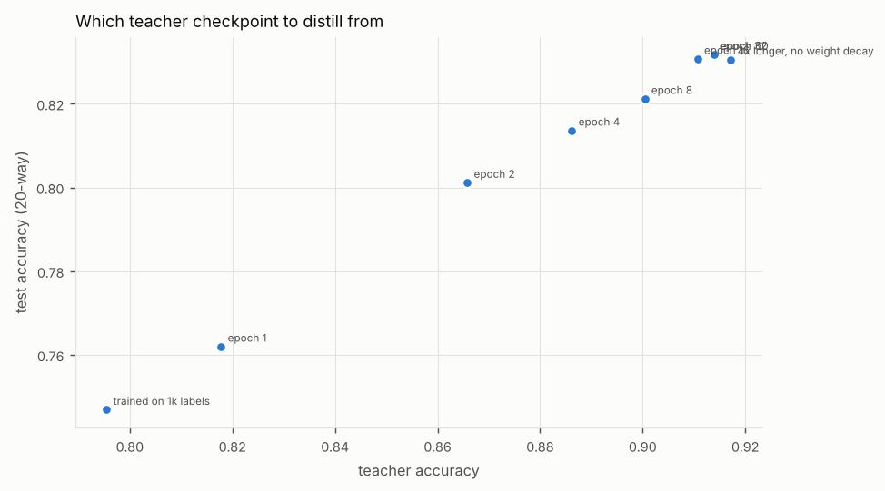

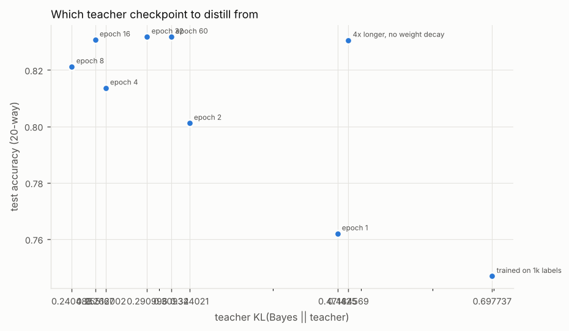

table

| teacher | teacher_kl_bayes | acc | target_ap | nll | ece | kl_bayes | teacher_acc | params | macs |
|---|---|---|---|---|---|---|---|---|---|
| epoch 1 | 0.4714 ± 0.000 | 0.7620 ± 0.002 | 0.9208 ± 0.006 | 0.7260 ± 0.007 | 0.0503 ± 0.003 | 0.6426 ± 0.006 | 0.8178 ± 0.000 | 2,132 | 2,048 |
| epoch 2 | 0.3240 ± 0.000 | 0.8012 ± 0.002 | 0.9468 ± 0.003 | 0.6133 ± 0.013 | 0.0325 ± 0.003 | 0.5314 ± 0.013 | 0.8658 ± 0.000 | 2,132 | 2,048 |
| epoch 4 | 0.2620 ± 0.000 | 0.8136 ± 0.004 | 0.9523 ± 0.005 | 0.5661 ± 0.015 | 0.0215 ± 0.001 | 0.4876 ± 0.015 | 0.8862 ± 0.000 | 2,132 | 2,048 |
| epoch 8 | 0.2405 ± 0.000 | 0.8212 ± 0.003 | 0.9570 ± 0.008 | 0.5396 ± 0.010 | 0.0133 ± 0.002 | 0.4590 ± 0.011 | 0.9004 ± 0.000 | 2,132 | 2,048 |
| epoch 16 | 0.2552 ± 0.000 | 0.8307 ± 0.003 | 0.9565 ± 0.003 | 0.5145 ± 0.012 | 0.0163 ± 0.004 | 0.4354 ± 0.014 | 0.9107 ± 0.000 | 2,132 | 2,048 |
| epoch 32 | 0.2910 ± 0.000 | 0.8318 ± 0.004 | 0.9550 ± 0.005 | 0.5109 ± 0.013 | 0.0141 ± 0.003 | 0.4329 ± 0.014 | 0.9137 ± 0.000 | 2,132 | 2,048 |
| epoch 60 | 0.3093 ± 0.000 | 0.8318 ± 0.005 | 0.9544 ± 0.005 | 0.5112 ± 0.013 | 0.0131 ± 0.003 | 0.4329 ± 0.015 | 0.9139 ± 0.000 | 2,132 | 2,048 |
| 4x longer, no weight decay | 0.4846 ± 0.000 | 0.8306 ± 0.003 | 0.9547 ± 0.006 | 0.5128 ± 0.011 | 0.0132 ± 0.003 | 0.4344 ± 0.013 | 0.9172 ± 0.000 | 2,132 | 2,048 |
| trained on 1k labels | 0.6977 ± 0.000 | 0.7469 ± 0.002 | 0.9017 ± 0.011 | 0.8083 ± 0.010 | 0.0408 ± 0.001 | 0.7283 ± 0.008 | 0.7955 ± 0.000 | 2,132 | 2,048 |

66s

### Label-smoothed teachers  (`teacher_smoothing`)

*Label smoothing makes a better *model*; does it make a better *teacher*?*

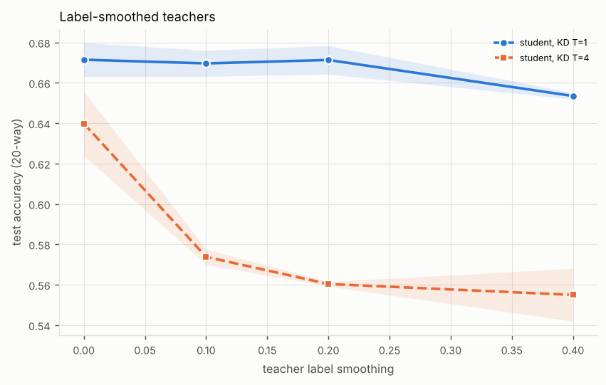

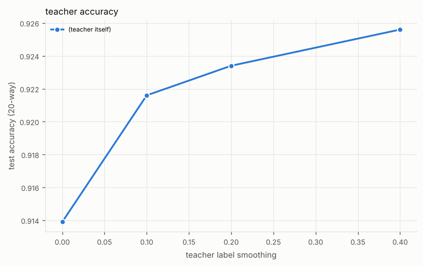

table

| method | smoothing | acc | target_ap | nll | ece | kl_bayes | teacher_acc | params | macs |
|---|---|---|---|---|---|---|---|---|---|
| (teacher itself) | 0.0000 | 0.9139 | 0.9885 | 0.3843 | 0.0554 | 0.3093 |  | 140,052 | 139,264 |
| student, KD T=1 | 0.0000 | 0.6714 ± 0.008 | 0.8619 ± 0.002 | 0.9909 ± 0.023 | 0.0190 ± 0.009 | 0.9093 ± 0.023 | 0.9139 ± 0.000 | 820 | 768 |
| student, KD T=4 | 0.0000 | 0.6398 ± 0.016 | 0.8455 ± 0.009 | 1.8185 ± 0.108 | 0.2411 ± 0.015 | 1.7335 ± 0.108 | 0.9139 ± 0.000 | 820 | 768 |
| (teacher itself) | 0.1000 | 0.9216 | 0.9891 | 0.4199 | 0.1593 | 0.3397 |  | 140,052 | 139,264 |
| student, KD T=1 | 0.1000 | 0.6696 ± 0.006 | 0.8678 ± 0.012 | 1.1422 ± 0.021 | 0.1860 ± 0.003 | 1.0586 ± 0.021 | 0.9216 ± 0.000 | 820 | 768 |
| student, KD T=4 | 0.1000 | 0.5738 ± 0.004 | 0.8421 ± 0.019 | 1.5312 ± 0.016 | 0.1991 ± 0.001 | 1.4465 ± 0.016 | 0.9216 ± 0.000 | 820 | 768 |
| (teacher itself) | 0.2000 | 0.9234 | 0.9899 | 0.5491 | 0.2535 | 0.4673 |  | 140,052 | 139,264 |
| student, KD T=1 | 0.2000 | 0.6713 ± 0.007 | 0.8640 ± 0.012 | 1.2799 ± 0.014 | 0.2651 ± 0.007 | 1.1960 ± 0.014 | 0.9234 ± 0.000 | 820 | 768 |
| student, KD T=4 | 0.2000 | 0.5604 ± 0.001 | 0.8443 ± 0.009 | 1.7241 ± 0.007 | 0.2601 ± 0.006 | 1.6387 ± 0.007 | 0.9234 ± 0.000 | 820 | 768 |
| (teacher itself) | 0.4000 | 0.9256 | 0.9904 | 0.8189 | 0.4151 | 0.7366 |  | 140,052 | 139,264 |
| student, KD T=1 | 0.4000 | 0.6535 ± 0.002 | 0.8629 ± 0.013 | 1.5658 ± 0.004 | 0.3623 ± 0.003 | 1.4812 ± 0.004 | 0.9256 ± 0.000 | 820 | 768 |
| student, KD T=4 | 0.4000 | 0.5550 ± 0.013 | 0.8253 ± 0.017 | 1.9555 ± 0.009 | 0.3353 ± 0.015 | 1.8705 ± 0.009 | 0.9256 ± 0.000 | 820 | 768 |

54s

## 3 · What the student sees (transfer data)

### Patient & consistent teaching  (`function_matching`)

*Beyer et al.: treat KD as *function matching* -- query the teacher on fresh augmented inputs every step and train for a long time. Does it keep paying?*

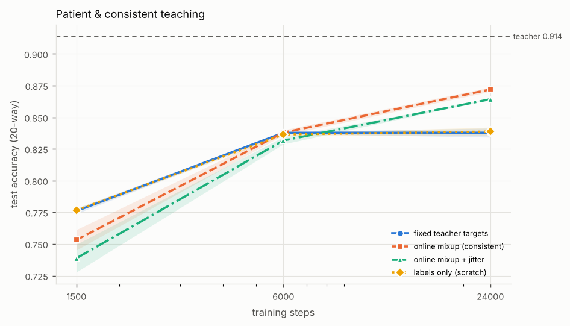

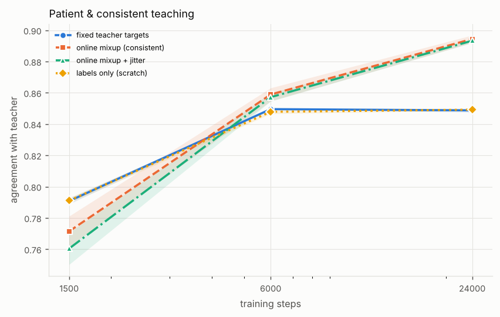

table

| method | steps | acc | target_ap | fidelity | nll | ece | kl_bayes | params | macs |
|---|---|---|---|---|---|---|---|---|---|
| fixed teacher targets | 1500 | 0.7761 ± 0.002 | 0.9222 ± 0.001 | 0.7907 ± 0.002 | 0.6810 ± 0.010 | 0.0312 ± 0.001 | 0.6008 ± 0.009 | 2,132 | 2,048 |
| online mixup (consistent) | 1500 | 0.7532 ± 0.008 | 0.9126 ± 0.001 | 0.7714 ± 0.010 | 0.7305 ± 0.021 | 0.0261 ± 0.001 | 0.6483 ± 0.021 | 2,132 | 2,048 |
| online mixup + jitter | 1500 | 0.7388 ± 0.011 | 0.9047 ± 0.000 | 0.7604 ± 0.010 | 0.7808 ± 0.025 | 0.0535 ± 0.003 | 0.6985 ± 0.025 | 2,132 | 2,048 |
| labels only (scratch) | 1500 | 0.7767 ± 0.001 | 0.9221 ± 0.001 | 0.7911 ± 0.002 | 0.6802 ± 0.009 | 0.0306 ± 0.002 | 0.6000 ± 0.008 | 2,132 | 2,048 |
| fixed teacher targets | 6000 | 0.8377 ± 0.001 | 0.9595 ± 0.000 | 0.8496 ± 0.000 | 0.5133 ± 0.004 | 0.0322 ± 0.003 | 0.4360 ± 0.004 | 2,132 | 2,048 |
| online mixup (consistent) | 6000 | 0.8379 ± 0.002 | 0.9592 ± 0.003 | 0.8589 ± 0.004 | 0.4843 ± 0.004 | 0.0086 ± 0.000 | 0.4023 ± 0.004 | 2,132 | 2,048 |
| online mixup + jitter | 6000 | 0.8317 ± 0.003 | 0.9490 ± 0.009 | 0.8572 ± 0.003 | 0.4976 ± 0.006 | 0.0199 ± 0.001 | 0.4180 ± 0.007 | 2,132 | 2,048 |
| labels only (scratch) | 6000 | 0.8364 ± 0.001 | 0.9597 ± 0.000 | 0.8478 ± 0.001 | 0.5178 ± 0.003 | 0.0347 ± 0.002 | 0.4395 ± 0.003 | 2,132 | 2,048 |
| fixed teacher targets | 24000 | 0.8378 ± 0.004 | 0.9603 ± 0.001 | 0.8488 ± 0.001 | 0.6753 ± 0.030 | 0.0895 ± 0.003 | 0.5975 ± 0.026 | 2,132 | 2,048 |
| online mixup (consistent) | 24000 | 0.8719 ± 0.002 | 0.9743 ± 0.001 | 0.8944 ± 0.002 | 0.3897 ± 0.006 | 0.0163 ± 0.000 | 0.3097 ± 0.004 | 2,132 | 2,048 |
| online mixup + jitter | 24000 | 0.8642 ± 0.000 | 0.9714 ± 0.005 | 0.8933 ± 0.001 | 0.4046 ± 0.000 | 0.0096 ± 0.002 | 0.3241 ± 0.000 | 2,132 | 2,048 |
| labels only (scratch) | 24000 | 0.8387 ± 0.003 | 0.9655 ± 0.001 | 0.8492 ± 0.001 | 0.6740 ± 0.029 | 0.0898 ± 0.006 | 0.6006 ± 0.029 | 2,132 | 2,048 |

302s

### Distilling without (much) real data  (`transfer_set`)

*Which inputs carry the teacher's knowledge best -- real labeled, real unlabeled, augmented, pure noise, or inputs dreamed up by inverting the teacher?*

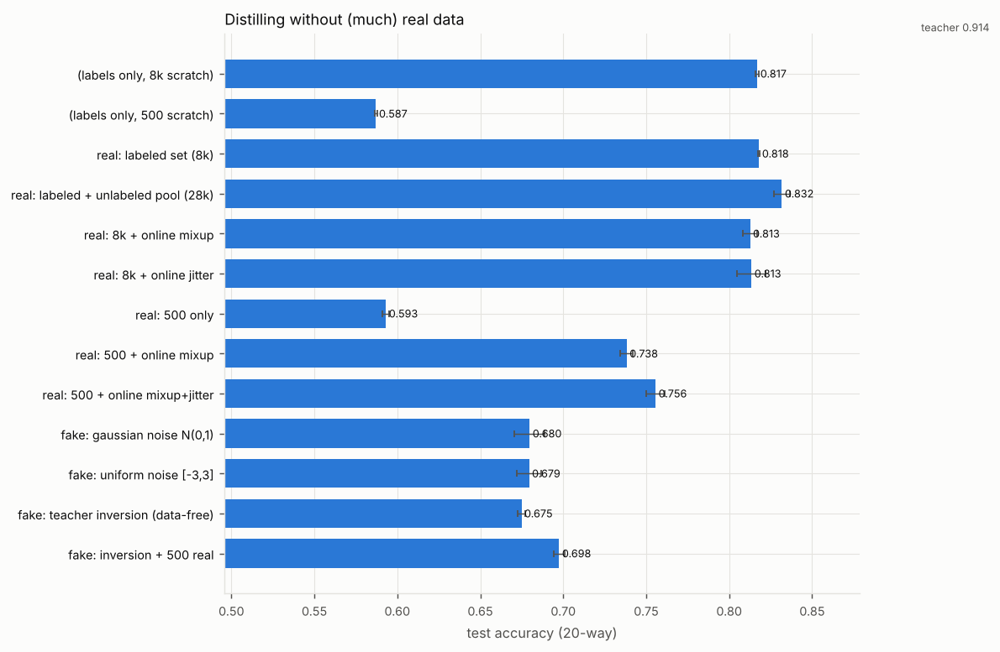

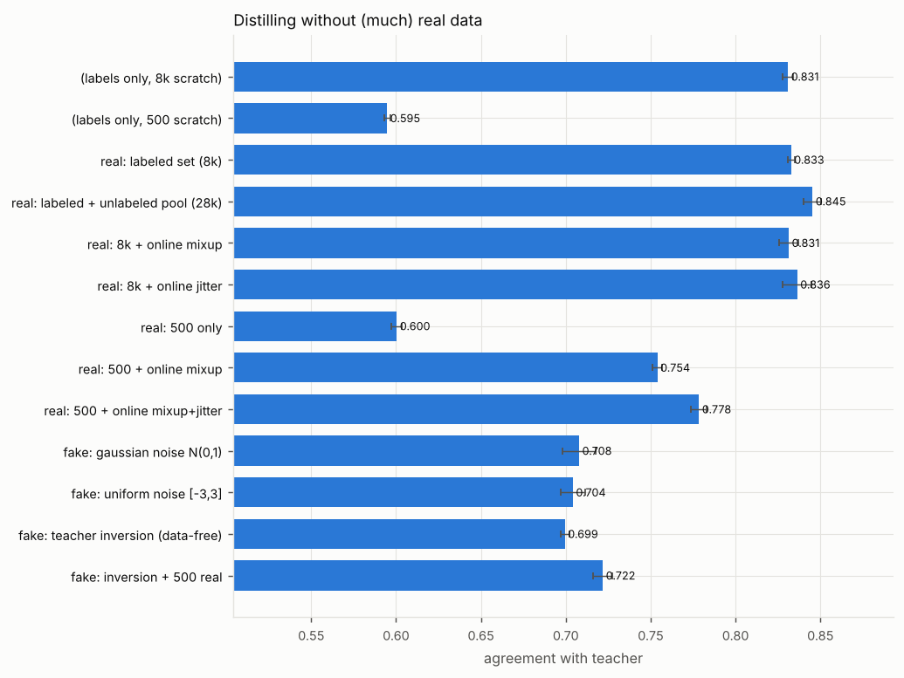

table

| source | acc | target_ap | fidelity | nll | ece | kl_bayes | params | macs |
|---|---|---|---|---|---|---|---|---|
| (labels only, 8k scratch) | 0.8170 ± 0.001 | 0.9524 ± 0.005 | 0.8309 ± 0.003 | 0.5538 ± 0.008 | 0.0092 ± 0.001 | 0.4758 ± 0.008 | 2,132 | 2,048 |
| (labels only, 500 scratch) | 0.5872 ± 0.001 | 0.7503 ± 0.023 | 0.5947 ± 0.002 | 2.5581 ± 0.040 | 0.2926 ± 0.003 | 2.4796 ± 0.041 | 2,132 | 2,048 |
| real: labeled set (8k) | 0.8180 ± 0.000 | 0.9515 ± 0.005 | 0.8327 ± 0.002 | 0.5532 ± 0.008 | 0.0100 ± 0.002 | 0.4752 ± 0.008 | 2,132 | 2,048 |
| real: labeled + unlabeled pool (28k) | 0.8318 ± 0.005 | 0.9544 ± 0.005 | 0.8454 ± 0.005 | 0.5112 ± 0.013 | 0.0131 ± 0.003 | 0.4329 ± 0.015 | 2,132 | 2,048 |
| real: 8k + online mixup | 0.8126 ± 0.004 | 0.9448 ± 0.004 | 0.8313 ± 0.006 | 0.5642 ± 0.015 | 0.0139 ± 0.002 | 0.4833 ± 0.015 | 2,132 | 2,048 |
| real: 8k + online jitter | 0.8134 ± 0.008 | 0.9443 ± 0.010 | 0.8363 ± 0.008 | 0.5985 ± 0.022 | 0.0882 ± 0.005 | 0.5167 ± 0.023 | 2,132 | 2,048 |
| real: 500 only | 0.5931 ± 0.002 | 0.7485 ± 0.033 | 0.6004 ± 0.003 | 2.4606 ± 0.034 | 0.2842 ± 0.004 | 2.3833 ± 0.033 | 2,132 | 2,048 |
| real: 500 + online mixup | 0.7382 ± 0.004 | 0.8882 ± 0.031 | 0.7539 ± 0.003 | 0.8167 ± 0.024 | 0.0585 ± 0.006 | 0.7354 ± 0.023 | 2,132 | 2,048 |
| real: 500 + online mixup+jitter | 0.7556 ± 0.005 | 0.9028 ± 0.007 | 0.7785 ± 0.005 | 0.7327 ± 0.009 | 0.0425 ± 0.005 | 0.6507 ± 0.008 | 2,132 | 2,048 |
| fake: gaussian noise N(0,1) | 0.6797 ± 0.009 | 0.8530 ± 0.007 | 0.7078 ± 0.010 | 0.9374 ± 0.027 | 0.0249 ± 0.003 | 0.8540 ± 0.029 | 2,132 | 2,048 |
| fake: uniform noise [-3,3] | 0.6794 ± 0.007 | 0.8439 ± 0.010 | 0.7041 ± 0.007 | 1.0532 ± 0.012 | 0.1625 ± 0.004 | 0.9689 ± 0.012 | 2,132 | 2,048 |
| fake: teacher inversion (data-free) | 0.6748 ± 0.003 | 0.8658 ± 0.043 | 0.6994 ± 0.003 | 1.6566 ± 0.019 | 0.2134 ± 0.001 | 1.5678 ± 0.016 | 2,132 | 2,048 |
| fake: inversion + 500 real | 0.6975 ± 0.003 | 0.8585 ± 0.042 | 0.7218 ± 0.006 | 1.3323 ± 0.034 | 0.1794 ± 0.002 | 1.2460 ± 0.034 | 2,132 | 2,048 |

107s

## 4 · Shrinking a trained model

### Every route to small, on one size/accuracy chart  (`compression_frontier`)

*Storage bits vs. accuracy for: small dense students, pruned teachers (sparse and structured), quantized versions of each, and the order of operations.*

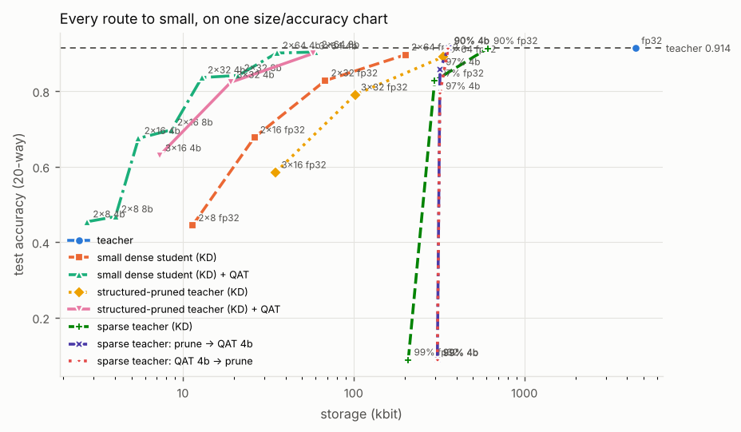

table

| family | config | acc | target_ap | nll | ece | kl_bayes | params | macs | kbits |
|---|---|---|---|---|---|---|---|---|---|
| teacher | fp32 | 0.9139 | 0.9885 | 0.3843 | 0.0554 | 0.3093 | 140052 | 139264 | 4,481.7 |
| small dense student (KD) | 2x8 fp32 | 0.4443 | 0.7415 | 1.6366 | 0.0111 | 1.5549 | 356 | 320 | 11.4 |
| small dense student (KD) + QAT | 2x8 8b | 0.4678 | 0.7732 | 1.5535 | 0.0128 | 1.4712 | 353 | 317 | 4.0 |
| small dense student (KD) + QAT | 2x8 4b | 0.4542 | 0.7609 | 1.5942 | 0.0137 | 1.5122 | 312 | 276 | 2.8 |
| small dense student (KD) | 2x16 fp32 | 0.6775 | 0.8601 | 0.9603 | 0.0187 | 0.8783 | 820 | 768 | 26.2 |
| small dense student (KD) + QAT | 2x16 8b | 0.6976 | 0.8719 | 0.9055 | 0.0222 | 0.8238 | 813 | 761 | 8.6 |
| small dense student (KD) + QAT | 2x16 4b | 0.6752 | 0.8569 | 0.9604 | 0.0208 | 0.8787 | 726 | 674 | 5.5 |
| small dense student (KD) | 2x32 fp32 | 0.8281 | 0.9530 | 0.5264 | 0.0166 | 0.4503 | 2132 | 2048 | 68.2 |
| small dense student (KD) + QAT | 2x32 8b | 0.8417 | 0.9627 | 0.4750 | 0.0086 | 0.3988 | 2126 | 2042 | 21.1 |
| small dense student (KD) + QAT | 2x32 4b | 0.8362 | 0.9563 | 0.5056 | 0.0093 | 0.4288 | 1893 | 1809 | 12.9 |
| small dense student (KD) | 2x64 fp32 | 0.8966 | 0.9859 | 0.3175 | 0.0074 | 0.2400 | 6292 | 6144 | 201.3 |
| small dense student (KD) + QAT | 2x64 8b | 0.9038 | 0.9874 | 0.3034 | 0.0155 | 0.2265 | 6251 | 6103 | 60.0 |
| small dense student (KD) + QAT | 2x64 4b | 0.9011 | 0.9874 | 0.3105 | 0.0166 | 0.2341 | 5633 | 5485 | 35.5 |
| structured-pruned teacher (KD) | 3x64 fp32 | 0.8911 | 0.9813 | 0.3215 | 0.0124 | 0.2450 | 10452 | 10240 | 334.5 |
| structured-pruned teacher (KD) + QAT | 3x64 4b | 0.9000 | 0.9838 | 0.3114 | 0.0258 | 0.2335 | 9287 | 9075 | 58.0 |
| structured-pruned teacher (KD) | 3x32 fp32 | 0.7905 | 0.9423 | 0.6379 | 0.0261 | 0.5565 | 3188 | 3072 | 102.0 |
| structured-pruned teacher (KD) + QAT | 3x32 4b | 0.8235 | 0.9560 | 0.5395 | 0.0090 | 0.4589 | 2814 | 2698 | 19.1 |
| structured-pruned teacher (KD) | 3x16 fp32 | 0.5848 | 0.8009 | 1.2493 | 0.0339 | 1.1688 | 1092 | 1024 | 34.9 |
| structured-pruned teacher (KD) + QAT | 3x16 4b | 0.6294 | 0.8288 | 1.1086 | 0.0142 | 1.0248 | 961 | 893 | 7.3 |
| sparse teacher (KD) | 90% fp32 | 0.9135 | 0.9869 | 0.2753 | 0.0156 | 0.1981 | 14714 | 13926 | 610.1 |
| sparse teacher: prune -> QAT 4b | 90% 4b | 0.9144 | 0.9860 | 0.2938 | 0.0300 | 0.2170 | 14405 | 13617 | 359.4 |
| sparse teacher: QAT 4b -> prune | 90% 4b | 0.9128 | 0.9866 | 0.2763 | 0.0168 | 0.1991 | 14358 | 13570 | 358.0 |
| sparse teacher (KD) | 97% fp32 | 0.8276 | 0.9548 | 0.5286 | 0.0311 | 0.4451 | 4966 | 4178 | 298.2 |
| sparse teacher: prune -> QAT 4b | 97% 4b | 0.8578 | 0.9681 | 0.4344 | 0.0076 | 0.3529 | 4817 | 4029 | 320.5 |
| sparse teacher: QAT 4b -> prune | 97% 4b | 0.7937 | 0.9457 | 0.6345 | 0.0347 | 0.5486 | 4868 | 4080 | 320.1 |
| sparse teacher (KD) | 99% fp32 | 0.0884 | 0.0387 | 2.9430 | 0.0169 | 2.8573 | 2181 | 1393 | 209.1 |
| sparse teacher: prune -> QAT 4b | 99% 4b | 0.0866 | 0.0374 | 2.9367 | 0.0117 | 2.8508 | 2181 | 1393 | 309.3 |
| sparse teacher: QAT 4b -> prune | 99% 4b | 0.0883 | 0.1760 | 2.9223 | 0.0204 | 2.8361 | 2179 | 1391 | 309.3 |

156s

### Deleting whole layers: plain vs. residual  (`layer_drop`)

*Remove k of 8 hidden layers from a deep teacher. Residual nets are said to behave like ensembles of shallow paths -- does that make depth removable? And is initializing a shallow student from the teacher's layers worth it?*

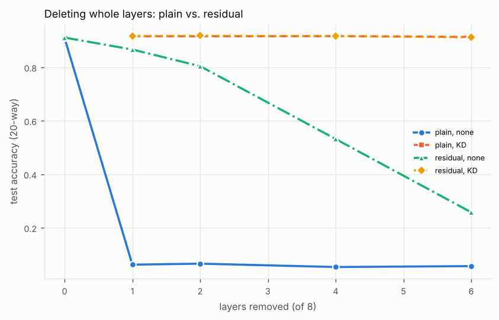

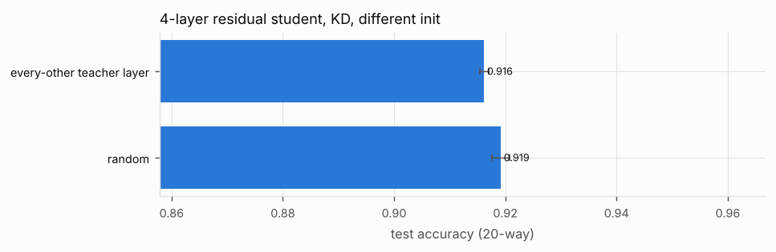

table

| dropped | init | kind | recovery | acc | target_ap | nll | ece | kl_bayes | params | macs |
|---|---|---|---|---|---|---|---|---|---|---|
| 0 |  | plain | none | 0.9097 | 0.9853 | 0.5380 | 0.0663 | 0.4709 | 119,828 | 118,784 |
| 1 |  | plain | none | 0.0622 | 0.1260 | 6.5793 | 0.5743 | 6.4796 | 103,316 | 102,400 |
| 1 |  | plain | KD | 0.9162 ± 0.002 | 0.9864 ± 0.002 | 0.3389 ± 0.001 | 0.0462 ± 0.001 | 0.2677 ± 0.002 | 103,316 | 102,400 |
| 2 |  | plain | none | 0.0660 | 0.1475 | 5.1513 | 0.4232 | 5.0648 | 86,804 | 86,016 |
| 2 |  | plain | KD | 0.9163 ± 0.001 | 0.9875 ± 0.001 | 0.3004 ± 0.000 | 0.0362 ± 0.001 | 0.2278 ± 0.001 | 86,804 | 86,016 |
| 4 |  | plain | none | 0.0534 | 0.0409 | 6.4899 | 0.5381 | 6.3991 | 53,780 | 53,248 |
| 4 |  | plain | KD | 0.9168 ± 0.001 | 0.9879 ± 0.000 | 0.2805 ± 0.001 | 0.0308 ± 0.001 | 0.2049 ± 0.000 | 53,780 | 53,248 |
| 6 |  | plain | none | 0.0568 | 0.0405 | 4.2185 | 0.3207 | 4.1300 | 20,756 | 20,480 |
| 6 |  | plain | KD | 0.9138 ± 0.001 | 0.9887 ± 0.000 | 0.2662 ± 0.001 | 0.0060 ± 0.000 | 0.1888 ± 0.001 | 20,756 | 20,480 |
| 0 |  | residual | none | 0.9113 | 0.9852 | 0.3935 | 0.0544 | 0.3351 | 119,828 | 118,784 |
| 1 |  | residual | none | 0.8666 | 0.9781 | 0.4970 | 0.0638 | 0.4186 | 103,316 | 102,400 |
| 1 |  | residual | KD | 0.9174 ± 0.001 | 0.9877 ± 0.000 | 0.2974 ± 0.002 | 0.0392 ± 0.000 | 0.2311 ± 0.002 | 103,316 | 102,400 |
| 2 |  | residual | none | 0.8044 | 0.9341 | 0.6386 | 0.0707 | 0.5595 | 86,804 | 86,016 |
| 2 |  | residual | KD | 0.9183 ± 0.001 | 0.9870 ± 0.001 | 0.2940 ± 0.003 | 0.0366 ± 0.000 | 0.2272 ± 0.003 | 86,804 | 86,016 |
| 4 |  | residual | none | 0.5320 | 0.6793 | 1.4882 | 0.1487 | 1.4051 | 53,780 | 53,248 |
| 4 |  | residual | KD | 0.9168 ± 0.001 | 0.9876 ± 0.000 | 0.2737 ± 0.001 | 0.0312 ± 0.001 | 0.2052 ± 0.001 | 53,780 | 53,248 |
| 6 |  | residual | none | 0.2580 | 0.1136 | 2.5937 | 0.1690 | 2.5097 | 20,756 | 20,480 |
| 6 |  | residual | KD | 0.9117 ± 0.000 | 0.9887 ± 0.000 | 0.2602 ± 0.001 | 0.0068 ± 0.001 | 0.1869 ± 0.000 | 20,756 | 20,480 |
|  | every-other teacher layer |  |  | 0.9162 ± 0.001 | 0.9871 ± 0.000 | 0.2974 ± 0.000 | 0.0391 ± 0.000 | 0.2309 ± 0.002 | 53,780 | 53,248 |
|  | random |  |  | 0.9192 ± 0.002 | 0.9885 ± 0.000 | 0.2670 ± 0.002 | 0.0295 ± 0.002 | 0.1933 ± 0.001 | 53,780 | 53,248 |

138s

### Lottery tickets: is the mask or the init the secret?  (`lottery_ticket`)

*Iterative magnitude pruning, then retrain the sparse net from (a) its original init, (b) an early-training rewind point, (c) a fresh random init, (d) its trained weights. Plus a random mask control.*

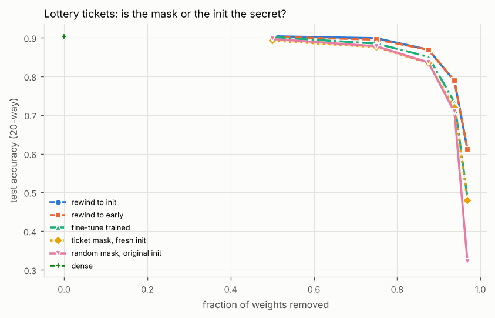

table

| method | sparsity | acc | target_ap | nll | ece | kl_bayes | params | macs |
|---|---|---|---|---|---|---|---|---|
| rewind to init | 0.5000 | 0.9038 ± 0.000 | 0.9881 ± 0.001 | 0.3413 ± 0.010 | 0.0409 ± 0.000 | 0.2695 ± 0.012 | 10,516 | 10,240 |
| rewind to early | 0.5000 | 0.9022 ± 0.001 | 0.9875 ± 0.002 | 0.3548 ± 0.010 | 0.0465 ± 0.000 | 0.2845 ± 0.014 | 10,516 | 10,240 |
| fine-tune trained | 0.5000 | 0.9013 ± 0.001 | 0.9871 ± 0.001 | 0.4396 ± 0.012 | 0.0598 ± 0.001 | 0.3737 ± 0.016 | 10,516 | 10,240 |
| ticket mask, fresh init | 0.5000 | 0.8921 ± 0.001 | 0.9868 ± 0.001 | 0.3289 ± 0.008 | 0.0295 ± 0.002 | 0.2543 ± 0.004 | 10,516 | 10,240 |
| random mask, original init | 0.5000 | 0.8966 ± 0.002 | 0.9840 ± 0.004 | 0.3280 ± 0.005 | 0.0262 ± 0.002 | 0.2532 ± 0.005 | 10,592 | 10,316 |
| rewind to init | 0.7500 | 0.8986 ± 0.001 | 0.9850 ± 0.001 | 0.3390 ± 0.006 | 0.0331 ± 0.000 | 0.2674 ± 0.005 | 5,396 | 5,120 |
| rewind to early | 0.7500 | 0.8951 ± 0.001 | 0.9836 ± 0.003 | 0.3523 ± 0.001 | 0.0392 ± 0.000 | 0.2791 ± 0.003 | 5,396 | 5,120 |
| fine-tune trained | 0.7500 | 0.8847 ± 0.000 | 0.9801 ± 0.002 | 0.4607 ± 0.012 | 0.0647 ± 0.001 | 0.3869 ± 0.010 | 5,396 | 5,120 |
| ticket mask, fresh init | 0.7500 | 0.8758 ± 0.003 | 0.9776 ± 0.002 | 0.3774 ± 0.002 | 0.0152 ± 0.001 | 0.2976 ± 0.002 | 5,396 | 5,120 |
| random mask, original init | 0.7500 | 0.8778 ± 0.004 | 0.9739 ± 0.001 | 0.3700 ± 0.010 | 0.0143 ± 0.002 | 0.2982 ± 0.008 | 5,319 | 5,043 |
| rewind to init | 0.8750 | 0.8690 ± 0.004 | 0.9714 ± 0.002 | 0.4072 ± 0.008 | 0.0196 ± 0.003 | 0.3307 ± 0.008 | 2,836 | 2,560 |
| rewind to early | 0.8750 | 0.8690 ± 0.001 | 0.9757 ± 0.002 | 0.4066 ± 0.005 | 0.0210 ± 0.002 | 0.3259 ± 0.003 | 2,836 | 2,560 |
| fine-tune trained | 0.8750 | 0.8506 ± 0.002 | 0.9647 ± 0.001 | 0.4944 ± 0.005 | 0.0449 ± 0.000 | 0.4179 ± 0.009 | 2,836 | 2,560 |
| ticket mask, fresh init | 0.8750 | 0.8344 ± 0.003 | 0.9557 ± 0.010 | 0.4974 ± 0.000 | 0.0126 ± 0.000 | 0.4159 ± 0.002 | 2,836 | 2,560 |
| random mask, original init | 0.8750 | 0.8361 ± 0.004 | 0.9662 ± 0.003 | 0.4911 ± 0.013 | 0.0113 ± 0.002 | 0.4104 ± 0.014 | 2,866 | 2,590 |
| rewind to init | 0.9375 | 0.7884 ± 0.000 | 0.9398 ± 0.015 | 0.6354 ± 0.001 | 0.0081 ± 0.000 | 0.5557 ± 0.002 | 1,556 | 1,280 |
| rewind to early | 0.9375 | 0.7887 ± 0.005 | 0.9436 ± 0.011 | 0.6306 ± 0.015 | 0.0120 ± 0.001 | 0.5517 ± 0.014 | 1,556 | 1,280 |
| fine-tune trained | 0.9375 | 0.7332 ± 0.004 | 0.8772 ± 0.024 | 0.8153 ± 0.013 | 0.0175 ± 0.002 | 0.7332 ± 0.013 | 1,556 | 1,280 |
| ticket mask, fresh init | 0.9375 | 0.7196 ± 0.009 | 0.8975 ± 0.015 | 0.8356 ± 0.029 | 0.0134 ± 0.002 | 0.7517 ± 0.028 | 1,556 | 1,280 |
| random mask, original init | 0.9375 | 0.7083 ± 0.006 | 0.8849 ± 0.029 | 0.8888 ± 0.019 | 0.0254 ± 0.002 | 0.8077 ± 0.019 | 1,551 | 1,275 |
| rewind to init | 0.9688 | 0.6118 ± 0.002 | 0.8856 ± 0.024 | 1.1521 ± 0.001 | 0.0158 ± 0.002 | 1.0697 ± 0.004 | 916 | 640 |
| rewind to early | 0.9688 | 0.6115 ± 0.001 | 0.8520 ± 0.025 | 1.1606 ± 0.001 | 0.0140 ± 0.000 | 1.0761 ± 0.005 | 916 | 640 |
| fine-tune trained | 0.9688 | 0.4866 ± 0.003 | 0.7557 ± 0.091 | 1.5410 ± 0.001 | 0.0125 ± 0.000 | 1.4567 ± 0.001 | 916 | 640 |
| ticket mask, fresh init | 0.9688 | 0.4801 ± 0.013 | 0.6859 ± 0.091 | 1.5803 ± 0.043 | 0.0177 ± 0.002 | 1.4953 ± 0.044 | 916 | 640 |
| random mask, original init | 0.9688 | 0.3219 ± 0.010 | 0.4538 ± 0.042 | 2.0903 ± 0.002 | 0.0178 ± 0.007 | 2.0085 ± 0.002 | 914 | 638 |
| dense | 0.0000 | 0.9040 ± 0.002 | 0.9881 ± 0.001 | 0.3284 ± 0.010 | 0.0395 ± 0.001 | 0.2561 ± 0.012 | 20,756 | 20,480 |

167s

### Low-rank factorization (SVD)  (`low_rank`)

*Replace each 256x256 matrix with a rank-r product. How low can r go, and how does it compare per-parameter with deleting neurons?*

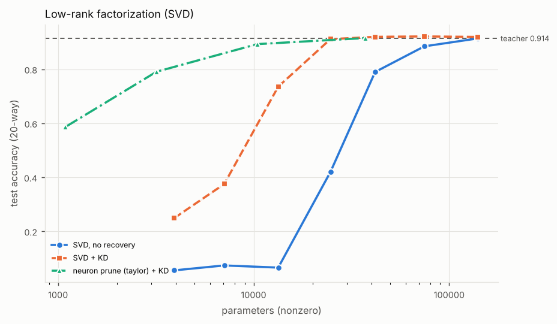

table

| method | acc | target_ap | nll | ece | kl_bayes | params | macs |
|---|---|---|---|---|---|---|---|
| SVD, no recovery | 0.9139 | 0.9885 | 0.3843 | 0.0554 | 0.3093 | 140,052 | 139,264 |
| SVD + KD | 0.9194 ± 0.000 | 0.9895 ± 0.000 | 0.3056 ± 0.001 | 0.0421 ± 0.000 | 0.2267 ± 0.001 | 140,052 | 139,264 |
| SVD, no recovery | 0.8846 | 0.9825 | 0.4860 | 0.0724 | 0.4109 | 74,644 | 73,728 |
| SVD + KD | 0.9213 ± 0.002 | 0.9896 ± 0.000 | 0.2925 ± 0.002 | 0.0386 ± 0.001 | 0.2154 ± 0.002 | 74,644 | 73,728 |
| SVD, no recovery | 0.7897 | 0.9597 | 0.9157 | 0.1321 | 0.8357 | 41,812 | 40,960 |
| SVD + KD | 0.9197 ± 0.000 | 0.9897 ± 0.000 | 0.2925 ± 0.001 | 0.0365 ± 0.000 | 0.2174 ± 0.001 | 41,812 | 40,960 |
| SVD, no recovery | 0.4197 | 0.5482 | 3.9823 | 0.4337 | 3.8883 | 24,708 | 23,872 |
| SVD + KD | 0.9113 ± 0.000 | 0.9858 ± 0.000 | 0.3012 ± 0.001 | 0.0294 ± 0.000 | 0.2263 ± 0.001 | 24,708 | 23,872 |
| SVD, no recovery | 0.0659 | 0.0781 | 7.0202 | 0.5824 | 6.9322 | 13,364 | 12,544 |
| SVD + KD | 0.7354 ± 0.002 | 0.9285 ± 0.002 | 0.8191 ± 0.000 | 0.0200 ± 0.000 | 0.7436 ± 0.000 | 13,364 | 12,544 |
| SVD, no recovery | 0.0739 | 0.0653 | 3.5762 | 0.1805 | 3.4922 | 7,076 | 6,272 |
| SVD + KD | 0.3751 ± 0.004 | 0.6592 ± 0.004 | 1.8326 ± 0.014 | 0.0209 ± 0.001 | 1.7489 ± 0.014 | 7,076 | 6,272 |
| SVD, no recovery | 0.0557 | 0.0564 | 3.1302 | 0.0666 | 3.0457 | 3,932 | 3,136 |
| SVD + KD | 0.2494 ± 0.000 | 0.5710 ± 0.008 | 2.2399 ± 0.000 | 0.0247 ± 0.001 | 2.1552 ± 0.000 | 3,932 | 3,136 |
| neuron prune (taylor) + KD | 0.9152 ± 0.001 | 0.9901 ± 0.000 | 0.2854 ± 0.001 | 0.0331 ± 0.000 | 0.2040 ± 0.001 | 37,268 | 36,864 |
| neuron prune (taylor) + KD | 0.8928 ± 0.002 | 0.9812 ± 0.000 | 0.3214 ± 0.000 | 0.0120 ± 0.000 | 0.2447 ± 0.000 | 10,452 | 10,240 |
| neuron prune (taylor) + KD | 0.7906 ± 0.000 | 0.9440 ± 0.002 | 0.6356 ± 0.002 | 0.0253 ± 0.001 | 0.5544 ± 0.002 | 3,188 | 3,072 |
| neuron prune (taylor) + KD | 0.5865 ± 0.002 | 0.7990 ± 0.002 | 1.2424 ± 0.007 | 0.0337 ± 0.000 | 1.1617 ± 0.007 | 1,092 | 1,024 |

85s

### Structured (neuron) pruning: criteria, recovery, budget  (`prune_structured`)

*Delete whole neurons so the net is genuinely smaller. Which importance criterion picks the right ones, and is a pruned teacher a head start over training the small shape fresh, at the same number of training steps?*

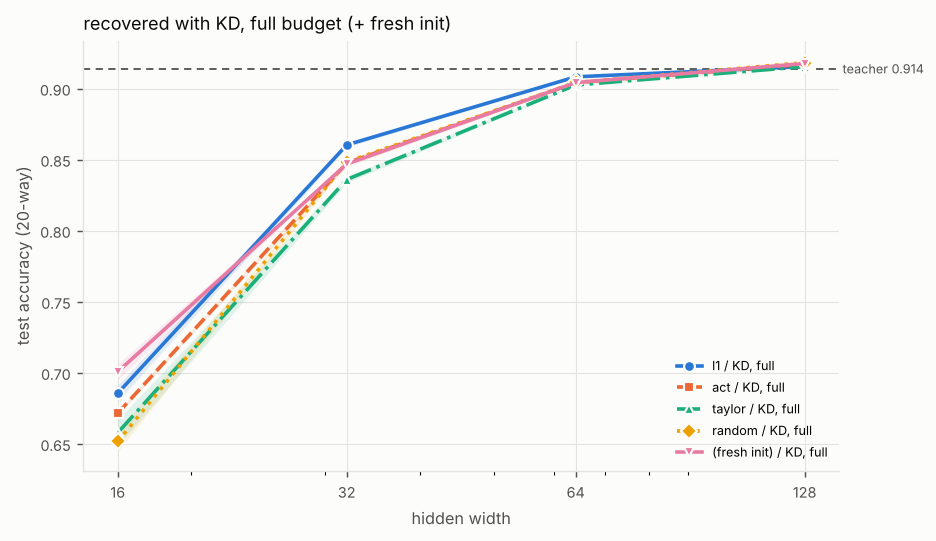

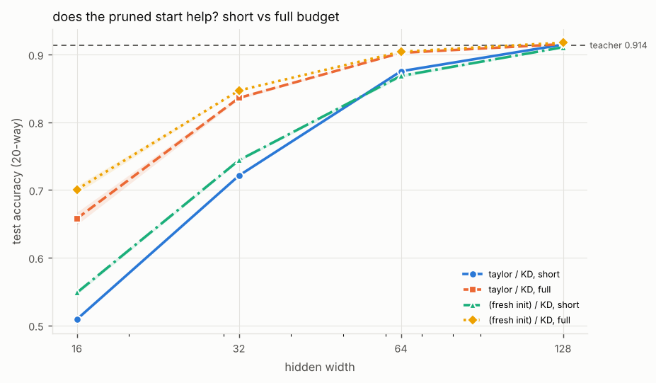

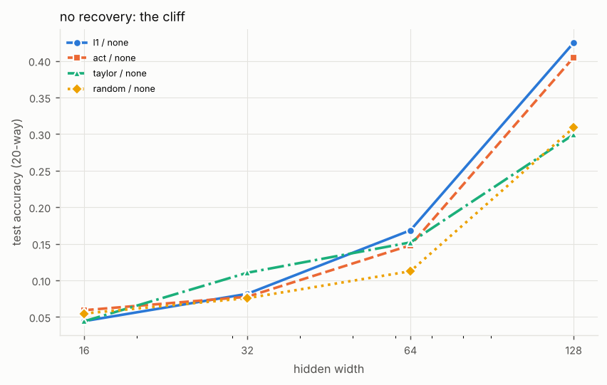

> 'short' = 750 steps, 'full' = 3000 steps; pruned and fresh nets use the same optimizer and learning rate, so the only difference is the starting weights.

table

| arm | width | criterion | recovery | acc | target_ap | nll | ece | kl_bayes | params | macs |
|---|---|---|---|---|---|---|---|---|---|---|
| l1 / none | 128 | l1 | none | 0.4247 | 0.6759 | 1.9903 | 0.1339 | 1.9054 | 37,268 | 36,864 |
| l1 / KD, short | 128 | l1 | KD, short | 0.9166 ± 0.000 | 0.9893 ± 0.001 | 0.2675 ± 0.000 | 0.0232 ± 0.000 | 0.1855 ± 0.000 | 37,268 | 36,864 |
| l1 / KD, full | 128 | l1 | KD, full | 0.9155 ± 0.000 | 0.9887 ± 0.000 | 0.3154 ± 0.000 | 0.0437 ± 0.000 | 0.2354 ± 0.000 | 37,268 | 36,864 |
| l1 / labels, full | 128 | l1 | labels, full | 0.9091 ± 0.001 | 0.9878 ± 0.000 | 0.4206 ± 0.000 | 0.0579 ± 0.000 | 0.3456 ± 0.001 | 37,268 | 36,864 |
| act / none | 128 | act | none | 0.4047 | 0.6845 | 2.1588 | 0.2747 | 2.0811 | 37,268 | 36,864 |
| act / KD, short | 128 | act | KD, short | 0.9165 ± 0.001 | 0.9884 ± 0.000 | 0.2635 ± 0.000 | 0.0143 ± 0.001 | 0.1842 ± 0.000 | 37,268 | 36,864 |
| act / KD, full | 128 | act | KD, full | 0.9171 ± 0.001 | 0.9897 ± 0.001 | 0.3008 ± 0.000 | 0.0392 ± 0.001 | 0.2224 ± 0.000 | 37,268 | 36,864 |
| act / labels, full | 128 | act | labels, full | 0.9098 ± 0.001 | 0.9863 ± 0.000 | 0.4078 ± 0.000 | 0.0555 ± 0.001 | 0.3337 ± 0.001 | 37,268 | 36,864 |
| taylor / none | 128 | taylor | none | 0.2994 | 0.3660 | 3.8637 | 0.4337 | 3.7839 | 37,268 | 36,864 |
| taylor / KD, short | 128 | taylor | KD, short | 0.9147 ± 0.000 | 0.9897 ± 0.000 | 0.2716 ± 0.000 | 0.0183 ± 0.001 | 0.1915 ± 0.000 | 37,268 | 36,864 |
| taylor / KD, full | 128 | taylor | KD, full | 0.9154 ± 0.000 | 0.9901 ± 0.000 | 0.3132 ± 0.001 | 0.0428 ± 0.000 | 0.2324 ± 0.001 | 37,268 | 36,864 |
| taylor / labels, full | 128 | taylor | labels, full | 0.9060 ± 0.000 | 0.9889 ± 0.000 | 0.4214 ± 0.003 | 0.0584 ± 0.000 | 0.3411 ± 0.002 | 37,268 | 36,864 |
| random / none | 128 | random | none | 0.3087 | 0.6028 | 2.1822 | 0.1755 | 2.0931 | 37,268 | 36,864 |
| random / KD, short | 128 | random | KD, short | 0.9158 ± 0.000 | 0.9871 ± 0.000 | 0.2623 ± 0.001 | 0.0177 ± 0.001 | 0.1867 ± 0.000 | 37,268 | 36,864 |
| random / KD, full | 128 | random | KD, full | 0.9182 ± 0.002 | 0.9881 ± 0.000 | 0.3082 ± 0.002 | 0.0396 ± 0.002 | 0.2315 ± 0.002 | 37,268 | 36,864 |
| random / labels, full | 128 | random | labels, full | 0.9087 ± 0.000 | 0.9856 ± 0.001 | 0.4043 ± 0.003 | 0.0567 ± 0.000 | 0.3384 ± 0.002 | 37,268 | 36,864 |
| (fresh init) / KD, short | 128 | (fresh init) | KD, short | 0.9108 ± 0.001 | 0.9887 ± 0.001 | 0.2701 ± 0.002 | 0.0052 ± 0.001 | 0.1964 ± 0.003 | 37,268 | 36,864 |
| (fresh init) / KD, full | 128 | (fresh init) | KD, full | 0.9176 ± 0.000 | 0.9905 ± 0.001 | 0.2843 ± 0.002 | 0.0335 ± 0.000 | 0.2095 ± 0.003 | 37,268 | 36,864 |
| (fresh init) / labels, full | 128 | (fresh init) | labels, full | 0.9086 ± 0.003 | 0.9878 ± 0.001 | 0.3815 ± 0.003 | 0.0528 ± 0.002 | 0.3129 ± 0.002 | 37,268 | 36,864 |
| l1 / none | 64 | l1 | none | 0.1685 | 0.1346 | 2.7938 | 0.0309 | 2.7110 | 10,452 | 10,240 |
| l1 / KD, short | 64 | l1 | KD, short | 0.8927 ± 0.000 | 0.9858 ± 0.000 | 0.3367 ± 0.001 | 0.0124 ± 0.000 | 0.2555 ± 0.000 | 10,452 | 10,240 |
| l1 / KD, full | 64 | l1 | KD, full | 0.9083 ± 0.000 | 0.9874 ± 0.001 | 0.3067 ± 0.000 | 0.0299 ± 0.001 | 0.2252 ± 0.000 | 10,452 | 10,240 |
| l1 / labels, full | 64 | l1 | labels, full | 0.8909 ± 0.001 | 0.9854 ± 0.002 | 0.4341 ± 0.000 | 0.0577 ± 0.000 | 0.3584 ± 0.000 | 10,452 | 10,240 |
| act / none | 64 | act | none | 0.1480 | 0.4782 | 2.7864 | 0.1785 | 2.7013 | 10,452 | 10,240 |
| act / KD, short | 64 | act | KD, short | 0.8739 ± 0.000 | 0.9772 ± 0.000 | 0.3911 ± 0.001 | 0.0229 ± 0.001 | 0.3090 ± 0.001 | 10,452 | 10,240 |
| act / KD, full | 64 | act | KD, full | 0.9041 ± 0.001 | 0.9867 ± 0.000 | 0.3023 ± 0.001 | 0.0226 ± 0.001 | 0.2233 ± 0.001 | 10,452 | 10,240 |
| act / labels, full | 64 | act | labels, full | 0.8877 ± 0.002 | 0.9798 ± 0.000 | 0.4094 ± 0.000 | 0.0500 ± 0.002 | 0.3342 ± 0.000 | 10,452 | 10,240 |
| taylor / none | 64 | taylor | none | 0.1519 | 0.1487 | 3.3144 | 0.2005 | 3.2330 | 10,452 | 10,240 |
| taylor / KD, short | 64 | taylor | KD, short | 0.8754 ± 0.001 | 0.9707 ± 0.000 | 0.3790 ± 0.001 | 0.0185 ± 0.000 | 0.3007 ± 0.001 | 10,452 | 10,240 |
| taylor / KD, full | 64 | taylor | KD, full | 0.9025 ± 0.000 | 0.9834 ± 0.000 | 0.3121 ± 0.000 | 0.0282 ± 0.001 | 0.2350 ± 0.000 | 10,452 | 10,240 |
| taylor / labels, full | 64 | taylor | labels, full | 0.8839 ± 0.000 | 0.9809 ± 0.001 | 0.4276 ± 0.000 | 0.0562 ± 0.001 | 0.3532 ± 0.000 | 10,452 | 10,240 |
| random / none | 64 | random | none | 0.1125 | 0.2280 | 2.8423 | 0.0224 | 2.7573 | 10,452 | 10,240 |
| random / KD, short | 64 | random | KD, short | 0.8754 ± 0.000 | 0.9747 ± 0.001 | 0.3836 ± 0.001 | 0.0168 ± 0.000 | 0.3021 ± 0.001 | 10,452 | 10,240 |
| random / KD, full | 64 | random | KD, full | 0.9043 ± 0.001 | 0.9859 ± 0.000 | 0.3057 ± 0.003 | 0.0273 ± 0.000 | 0.2252 ± 0.002 | 10,452 | 10,240 |
| random / labels, full | 64 | random | labels, full | 0.8871 ± 0.002 | 0.9816 ± 0.001 | 0.4159 ± 0.008 | 0.0563 ± 0.001 | 0.3408 ± 0.009 | 10,452 | 10,240 |
| (fresh init) / KD, short | 64 | (fresh init) | KD, short | 0.8685 ± 0.002 | 0.9719 ± 0.003 | 0.3986 ± 0.008 | 0.0166 ± 0.002 | 0.3188 ± 0.007 | 10,452 | 10,240 |
| (fresh init) / KD, full | 64 | (fresh init) | KD, full | 0.9042 ± 0.001 | 0.9853 ± 0.000 | 0.2988 ± 0.002 | 0.0229 ± 0.001 | 0.2205 ± 0.003 | 10,452 | 10,240 |
| (fresh init) / labels, full | 64 | (fresh init) | labels, full | 0.8851 ± 0.001 | 0.9787 ± 0.001 | 0.4225 ± 0.008 | 0.0540 ± 0.001 | 0.3444 ± 0.008 | 10,452 | 10,240 |
| l1 / none | 32 | l1 | none | 0.0816 | 0.1968 | 2.9661 | 0.0177 | 2.8813 | 3,188 | 3,072 |
| l1 / KD, short | 32 | l1 | KD, short | 0.7759 ± 0.003 | 0.9391 ± 0.001 | 0.6869 ± 0.012 | 0.0464 ± 0.001 | 0.6017 ± 0.012 | 3,188 | 3,072 |
| l1 / KD, full | 32 | l1 | KD, full | 0.8603 ± 0.002 | 0.9743 ± 0.003 | 0.4308 ± 0.008 | 0.0075 ± 0.001 | 0.3464 ± 0.009 | 3,188 | 3,072 |
| l1 / labels, full | 32 | l1 | labels, full | 0.8426 ± 0.001 | 0.9714 ± 0.004 | 0.4966 ± 0.002 | 0.0266 ± 0.000 | 0.4137 ± 0.004 | 3,188 | 3,072 |
| act / none | 32 | act | none | 0.0776 | 0.1299 | 2.9688 | 0.0276 | 2.8836 | 3,188 | 3,072 |
| act / KD, short | 32 | act | KD, short | 0.7320 ± 0.002 | 0.9019 ± 0.002 | 0.8131 ± 0.005 | 0.0485 ± 0.001 | 0.7313 ± 0.005 | 3,188 | 3,072 |
| act / KD, full | 32 | act | KD, full | 0.8476 ± 0.002 | 0.9607 ± 0.001 | 0.4658 ± 0.005 | 0.0076 ± 0.002 | 0.3865 ± 0.004 | 3,188 | 3,072 |
| act / labels, full | 32 | act | labels, full | 0.8273 ± 0.001 | 0.9528 ± 0.002 | 0.5341 ± 0.001 | 0.0216 ± 0.002 | 0.4545 ± 0.002 | 3,188 | 3,072 |
| taylor / none | 32 | taylor | none | 0.1104 | 0.0823 | 2.9917 | 0.0100 | 2.9079 | 3,188 | 3,072 |
| taylor / KD, short | 32 | taylor | KD, short | 0.7212 ± 0.000 | 0.9044 ± 0.002 | 0.8453 ± 0.002 | 0.0472 ± 0.002 | 0.7628 ± 0.002 | 3,188 | 3,072 |
| taylor / KD, full | 32 | taylor | KD, full | 0.8360 ± 0.002 | 0.9611 ± 0.000 | 0.5042 ± 0.003 | 0.0095 ± 0.000 | 0.4251 ± 0.003 | 3,188 | 3,072 |
| taylor / labels, full | 32 | taylor | labels, full | 0.8197 ± 0.000 | 0.9506 ± 0.001 | 0.5665 ± 0.001 | 0.0199 ± 0.001 | 0.4891 ± 0.001 | 3,188 | 3,072 |
| random / none | 32 | random | none | 0.0757 | 0.0937 | 2.9866 | 0.0205 | 2.9016 | 3,188 | 3,072 |
| random / KD, short | 32 | random | KD, short | 0.7313 ± 0.005 | 0.8935 ± 0.002 | 0.7996 ± 0.009 | 0.0452 ± 0.001 | 0.7160 ± 0.010 | 3,188 | 3,072 |
| random / KD, full | 32 | random | KD, full | 0.8484 ± 0.001 | 0.9621 ± 0.000 | 0.4608 ± 0.003 | 0.0070 ± 0.001 | 0.3794 ± 0.004 | 3,188 | 3,072 |
| random / labels, full | 32 | random | labels, full | 0.8259 ± 0.004 | 0.9531 ± 0.002 | 0.5412 ± 0.009 | 0.0203 ± 0.002 | 0.4605 ± 0.010 | 3,188 | 3,072 |
| (fresh init) / KD, short | 32 | (fresh init) | KD, short | 0.7439 ± 0.002 | 0.9008 ± 0.006 | 0.7646 ± 0.005 | 0.0343 ± 0.003 | 0.6846 ± 0.007 | 3,188 | 3,072 |
| (fresh init) / KD, full | 32 | (fresh init) | KD, full | 0.8469 ± 0.000 | 0.9676 ± 0.006 | 0.4662 ± 0.000 | 0.0065 ± 0.000 | 0.3887 ± 0.002 | 3,188 | 3,072 |
| (fresh init) / labels, full | 32 | (fresh init) | labels, full | 0.8251 ± 0.000 | 0.9531 ± 0.004 | 0.5504 ± 0.000 | 0.0293 ± 0.002 | 0.4744 ± 0.001 | 3,188 | 3,072 |
| l1 / none | 16 | l1 | none | 0.0443 | 0.2439 | 2.9962 | 0.0184 | 2.9113 | 1,092 | 1,024 |
| l1 / KD, short | 16 | l1 | KD, short | 0.5512 ± 0.001 | 0.7468 ± 0.010 | 1.3400 ± 0.003 | 0.0390 ± 0.001 | 1.2561 ± 0.004 | 1,092 | 1,024 |
| l1 / KD, full | 16 | l1 | KD, full | 0.6856 ± 0.006 | 0.8731 ± 0.011 | 0.9410 ± 0.015 | 0.0169 ± 0.000 | 0.8586 ± 0.014 | 1,092 | 1,024 |
| l1 / labels, full | 16 | l1 | labels, full | 0.6801 ± 0.004 | 0.8698 ± 0.017 | 0.9714 ± 0.017 | 0.0136 ± 0.001 | 0.8899 ± 0.014 | 1,092 | 1,024 |
| act / none | 16 | act | none | 0.0592 | 0.0639 | 3.0077 | 0.0129 | 2.9228 | 1,092 | 1,024 |
| act / KD, short | 16 | act | KD, short | 0.5161 ± 0.005 | 0.7424 ± 0.005 | 1.4111 ± 0.007 | 0.0268 ± 0.006 | 1.3271 ± 0.006 | 1,092 | 1,024 |
| act / KD, full | 16 | act | KD, full | 0.6716 ± 0.002 | 0.8785 ± 0.003 | 0.9833 ± 0.009 | 0.0197 ± 0.000 | 0.9026 ± 0.009 | 1,092 | 1,024 |
| act / labels, full | 16 | act | labels, full | 0.6664 ± 0.000 | 0.8565 ± 0.000 | 1.0128 ± 0.006 | 0.0154 ± 0.000 | 0.9315 ± 0.006 | 1,092 | 1,024 |
| taylor / none | 16 | taylor | none | 0.0441 | 0.0963 | 3.0334 | 0.0437 | 2.9488 | 1,092 | 1,024 |
| taylor / KD, short | 16 | taylor | KD, short | 0.5090 ± 0.000 | 0.7790 ± 0.001 | 1.4419 ± 0.000 | 0.0256 ± 0.001 | 1.3601 ± 0.000 | 1,092 | 1,024 |
| taylor / KD, full | 16 | taylor | KD, full | 0.6579 ± 0.009 | 0.8464 ± 0.006 | 1.0201 ± 0.026 | 0.0205 ± 0.003 | 0.9381 ± 0.025 | 1,092 | 1,024 |
| taylor / labels, full | 16 | taylor | labels, full | 0.6422 ± 0.004 | 0.8246 ± 0.001 | 1.0677 ± 0.005 | 0.0126 ± 0.001 | 0.9832 ± 0.005 | 1,092 | 1,024 |
| random / none | 16 | random | none | 0.0547 | 0.0595 | 2.9954 | 0.0051 | 2.9108 | 1,092 | 1,024 |
| random / KD, short | 16 | random | KD, short | 0.5036 ± 0.003 | 0.7965 ± 0.011 | 1.4527 ± 0.001 | 0.0238 ± 0.000 | 1.3705 ± 0.001 | 1,092 | 1,024 |
| random / KD, full | 16 | random | KD, full | 0.6517 ± 0.007 | 0.8785 ± 0.006 | 1.0252 ± 0.019 | 0.0177 ± 0.002 | 0.9444 ± 0.020 | 1,092 | 1,024 |
| random / labels, full | 16 | random | labels, full | 0.6452 ± 0.002 | 0.8773 ± 0.007 | 1.0445 ± 0.002 | 0.0122 ± 0.002 | 0.9666 ± 0.001 | 1,092 | 1,024 |
| (fresh init) / KD, short | 16 | (fresh init) | KD, short | 0.5484 ± 0.003 | 0.7930 ± 0.017 | 1.3399 ± 0.015 | 0.0295 ± 0.003 | 1.2567 ± 0.016 | 1,092 | 1,024 |
| (fresh init) / KD, full | 16 | (fresh init) | KD, full | 0.7007 ± 0.006 | 0.8684 ± 0.012 | 0.9060 ± 0.013 | 0.0169 ± 0.003 | 0.8250 ± 0.013 | 1,092 | 1,024 |
| (fresh init) / labels, full | 16 | (fresh init) | labels, full | 0.6853 ± 0.001 | 0.8610 ± 0.005 | 0.9554 ± 0.008 | 0.0098 ± 0.002 | 0.8734 ± 0.007 | 1,092 | 1,024 |

190s

### Magnitude pruning: the cliff and the regrow  (`prune_unstructured`)

*How sparse can the teacher get? Compare one-shot cuts with and without recovery, recovery by labels vs. by distilling from the unpruned self, gradual pruning, and a dense small model with the same weight count.*

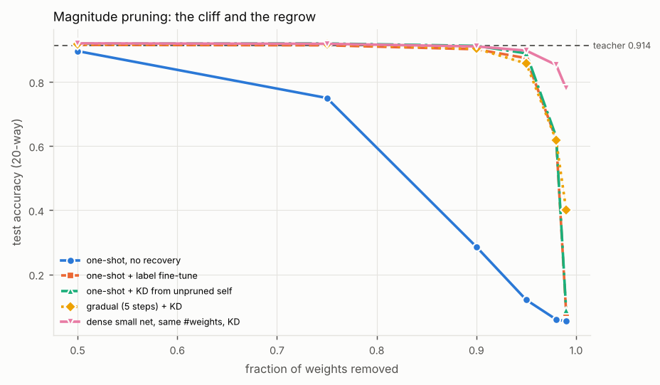

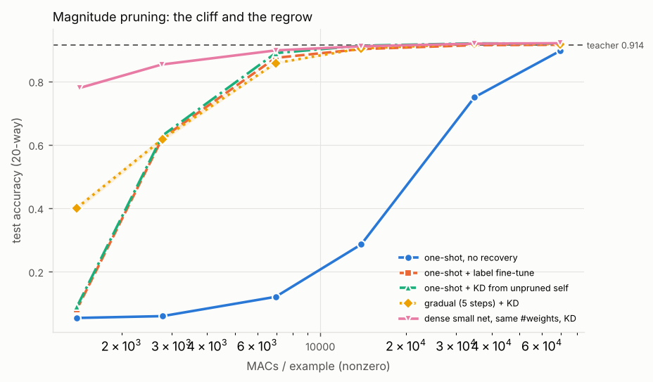

table

| method | sparsity | acc | target_ap | nll | ece | kl_bayes | params | macs |
|---|---|---|---|---|---|---|---|---|
| one-shot, no recovery | 0.5000 | 0.8961 ± 0.000 | 0.9814 ± 0.000 | 0.4109 ± 0.000 | 0.0556 ± 0.000 | 0.3314 ± 0.000 | 70,420 | 69,632 |
| one-shot + label fine-tune | 0.5000 | 0.9154 ± 0.000 | 0.9885 ± 0.000 | 0.3959 ± 0.004 | 0.0552 ± 0.001 | 0.3225 ± 0.004 | 70,420 | 69,632 |
| one-shot + KD from unpruned self | 0.5000 | 0.9193 ± 0.000 | 0.9893 ± 0.000 | 0.3121 ± 0.001 | 0.0426 ± 0.001 | 0.2353 ± 0.000 | 70,420 | 69,632 |
| gradual (5 steps) + KD | 0.5000 | 0.9173 ± 0.001 | 0.9886 ± 0.001 | 0.3036 ± 0.001 | 0.0402 ± 0.001 | 0.2239 ± 0.000 | 70,420 | 69,632 |
| dense small net, same #weights, KD | 0.5000 | 0.9203 ± 0.002 | 0.9899 ± 0.000 | 0.2688 ± 0.002 | 0.0313 ± 0.002 | 0.1931 ± 0.001 | 69,956 | 69,440 |
| one-shot, no recovery | 0.7500 | 0.7500 ± 0.000 | 0.9345 ± 0.000 | 0.7708 ± 0.000 | 0.0444 ± 0.000 | 0.6879 ± 0.000 | 35,604 | 34,816 |
| one-shot + label fine-tune | 0.7500 | 0.9142 ± 0.000 | 0.9876 ± 0.000 | 0.3594 ± 0.001 | 0.0485 ± 0.000 | 0.2849 ± 0.002 | 35,604 | 34,816 |
| one-shot + KD from unpruned self | 0.7500 | 0.9199 ± 0.001 | 0.9893 ± 0.000 | 0.2989 ± 0.001 | 0.0371 ± 0.000 | 0.2222 ± 0.001 | 35,604 | 34,816 |
| gradual (5 steps) + KD | 0.7500 | 0.9183 ± 0.001 | 0.9896 ± 0.000 | 0.2743 ± 0.001 | 0.0301 ± 0.001 | 0.1978 ± 0.002 | 35,604 | 34,816 |
| dense small net, same #weights, KD | 0.7500 | 0.9188 ± 0.000 | 0.9900 ± 0.001 | 0.2646 ± 0.003 | 0.0259 ± 0.000 | 0.1873 ± 0.002 | 35,075 | 34,713 |
| one-shot, no recovery | 0.9000 | 0.2860 ± 0.000 | 0.6356 ± 0.000 | 2.3230 ± 0.000 | 0.0797 ± 0.000 | 2.2373 ± 0.000 | 14,714 | 13,926 |
| one-shot + label fine-tune | 0.9000 | 0.9019 ± 0.000 | 0.9862 ± 0.000 | 0.3258 ± 0.001 | 0.0330 ± 0.001 | 0.2500 ± 0.000 | 14,714 | 13,926 |
| one-shot + KD from unpruned self | 0.9000 | 0.9125 ± 0.001 | 0.9871 ± 0.000 | 0.2741 ± 0.001 | 0.0159 ± 0.000 | 0.1979 ± 0.000 | 14,714 | 13,926 |
| gradual (5 steps) + KD | 0.9000 | 0.9038 ± 0.001 | 0.9865 ± 0.000 | 0.2921 ± 0.002 | 0.0114 ± 0.000 | 0.2107 ± 0.002 | 14,714 | 13,926 |
| dense small net, same #weights, KD | 0.9000 | 0.9107 ± 0.001 | 0.9871 ± 0.001 | 0.2775 ± 0.002 | 0.0163 ± 0.000 | 0.1992 ± 0.002 | 14,131 | 13,905 |
| one-shot, no recovery | 0.9500 | 0.1206 ± 0.000 | 0.1936 ± 0.000 | 2.8769 ± 0.000 | 0.0313 ± 0.000 | 2.7920 ± 0.000 | 7,751 | 6,963 |
| one-shot + label fine-tune | 0.9500 | 0.8741 ± 0.001 | 0.9717 ± 0.000 | 0.3837 ± 0.004 | 0.0075 ± 0.000 | 0.3024 ± 0.003 | 7,751 | 6,963 |
| one-shot + KD from unpruned self | 0.9500 | 0.8891 ± 0.001 | 0.9797 ± 0.000 | 0.3430 ± 0.001 | 0.0117 ± 0.000 | 0.2632 ± 0.001 | 7,751 | 6,963 |
| gradual (5 steps) + KD | 0.9500 | 0.8576 ± 0.004 | 0.9670 ± 0.000 | 0.4464 ± 0.008 | 0.0574 ± 0.002 | 0.3670 ± 0.008 | 7,751 | 6,963 |
| dense small net, same #weights, KD | 0.9500 | 0.8977 ± 0.001 | 0.9843 ± 0.002 | 0.3054 ± 0.004 | 0.0114 ± 0.001 | 0.2287 ± 0.003 | 7,127 | 6,969 |
| one-shot, no recovery | 0.9800 | 0.0597 ± 0.000 | 0.0662 ± 0.000 | 2.9909 ± 0.000 | 0.0002 ± 0.000 | 2.9064 ± 0.000 | 3,573 | 2,785 |
| one-shot + label fine-tune | 0.9800 | 0.6215 ± 0.005 | 0.8250 ± 0.002 | 1.1661 ± 0.015 | 0.0635 ± 0.003 | 1.0798 ± 0.015 | 3,573 | 2,785 |
| one-shot + KD from unpruned self | 0.9800 | 0.6289 ± 0.000 | 0.8317 ± 0.003 | 1.1443 ± 0.009 | 0.0669 ± 0.005 | 1.0570 ± 0.008 | 3,573 | 2,785 |
| gradual (5 steps) + KD | 0.9800 | 0.6179 ± 0.008 | 0.8432 ± 0.005 | 1.2086 ± 0.021 | 0.1191 ± 0.000 | 1.1251 ± 0.020 | 3,573 | 2,785 |
| dense small net, same #weights, KD | 0.9800 | 0.8531 ± 0.000 | 0.9657 ± 0.004 | 0.4467 ± 0.004 | 0.0074 ± 0.000 | 0.3676 ± 0.005 | 2,867 | 2,769 |
| one-shot, no recovery | 0.9900 | 0.0540 ± 0.000 | 0.0384 ± 0.000 | 2.9986 ± 0.000 | 0.0079 ± 0.000 | 2.9140 ± 0.000 | 2,181 | 1,393 |
| one-shot + label fine-tune | 0.9900 | 0.0804 ± 0.000 | 0.0378 ± 0.000 | 2.9447 ± 0.000 | 0.0138 ± 0.000 | 2.8592 ± 0.000 | 2,181 | 1,393 |
| one-shot + KD from unpruned self | 0.9900 | 0.0883 ± 0.000 | 0.0387 ± 0.000 | 2.9431 ± 0.000 | 0.0169 ± 0.000 | 2.8574 ± 0.000 | 2,181 | 1,393 |
| gradual (5 steps) + KD | 0.9900 | 0.4007 ± 0.009 | 0.6422 ± 0.064 | 1.8342 ± 0.028 | 0.0825 ± 0.005 | 1.7514 ± 0.028 | 2,181 | 1,393 |
| dense small net, same #weights, KD | 0.9900 | 0.7792 ± 0.004 | 0.9252 ± 0.007 | 0.6635 ± 0.008 | 0.0127 ± 0.003 | 0.5826 ± 0.006 | 1,495 | 1,425 |

391s

### Quantization: PTQ vs. QAT, labels vs. KD, big vs. small  (`quantization`)

*How few bits per weight survive? Does a per-group scale rescue low bits, does quantization-aware training rescue more, and do small models tolerate it worse?*

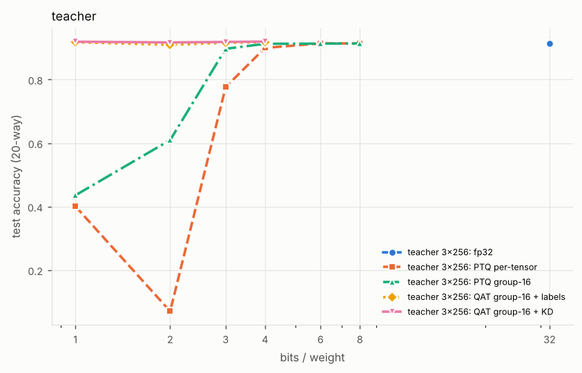

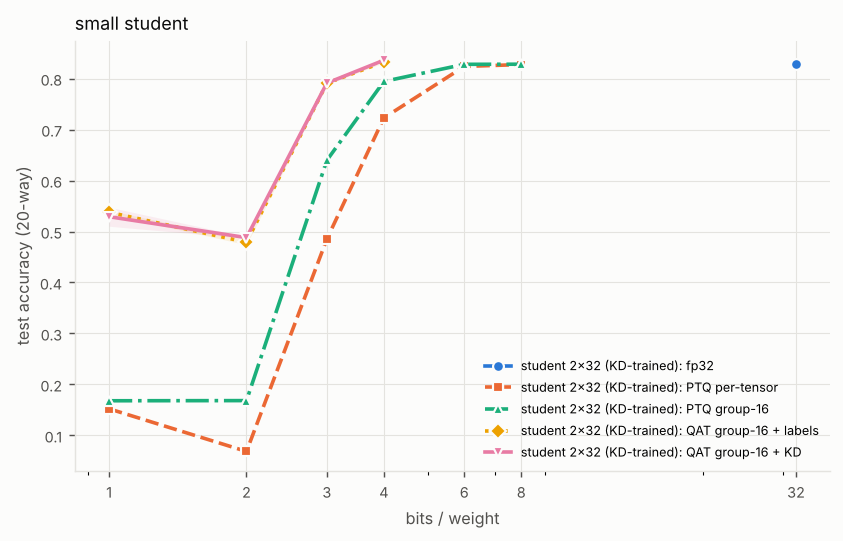

table

| bits | model | method | acc | target_ap | nll | ece | kl_bayes | params | macs | kbits |
|---|---|---|---|---|---|---|---|---|---|---|
| 32 | teacher 3x256 | fp32 | 0.9139 | 0.9885 | 0.3843 | 0.0554 | 0.3093 | 140,052 | 139,264 | 4,481.7 |
| 8 | teacher 3x256 | PTQ per-tensor | 0.9140 | 0.9885 | 0.3841 | 0.0551 | 0.3089 | 137,902 | 137,114 | 1,139.4 |
| 8 | teacher 3x256 | PTQ group-16 | 0.9138 | 0.9886 | 0.3843 | 0.0556 | 0.3094 | 139,129 | 138,341 | 1,278.6 |
| 6 | teacher 3x256 | PTQ per-tensor | 0.9139 | 0.9882 | 0.3856 | 0.0554 | 0.3099 | 131,540 | 130,752 | 860.9 |
| 6 | teacher 3x256 | PTQ group-16 | 0.9133 | 0.9884 | 0.3854 | 0.0559 | 0.3103 | 136,208 | 135,420 | 1,000.1 |
| 4 | teacher 3x256 | PTQ per-tensor | 0.8998 | 0.9850 | 0.4660 | 0.0676 | 0.3914 | 102,817 | 102,029 | 582.3 |
| 4 | teacher 3x256 | PTQ group-16 | 0.9128 | 0.9887 | 0.4002 | 0.0552 | 0.3252 | 123,497 | 122,709 | 721.5 |
| 4 | teacher 3x256 | QAT group-16 + labels | 0.9181 ± 0.001 | 0.9898 ± 0.000 | 0.3932 ± 0.002 | 0.0541 ± 0.001 | 0.3230 ± 0.004 | 123,502 | 122,714 | 721.5 |
| 4 | teacher 3x256 | QAT group-16 + KD | 0.9198 ± 0.000 | 0.9895 ± 0.000 | 0.2986 ± 0.002 | 0.0406 ± 0.000 | 0.2215 ± 0.001 | 123,482 | 122,694 | 721.5 |
| 3 | teacher 3x256 | PTQ per-tensor | 0.7766 | 0.9611 | 1.2248 | 0.1587 | 1.1534 | 60,345 | 59,557 | 443.1 |
| 3 | teacher 3x256 | PTQ group-16 | 0.8970 | 0.9871 | 0.4696 | 0.0647 | 0.4024 | 102,398 | 101,610 | 582.3 |
| 3 | teacher 3x256 | QAT group-16 + labels | 0.9160 ± 0.001 | 0.9902 ± 0.001 | 0.3876 ± 0.003 | 0.0541 ± 0.001 | 0.3148 ± 0.003 | 102,134 | 101,346 | 582.3 |
| 3 | teacher 3x256 | QAT group-16 + KD | 0.9186 ± 0.001 | 0.9882 ± 0.000 | 0.3010 ± 0.002 | 0.0404 ± 0.001 | 0.2212 ± 0.002 | 102,223 | 101,435 | 582.3 |
| 2 | teacher 3x256 | PTQ per-tensor | 0.0707 | 0.1009 | 3.0212 | 0.0312 | 2.9371 | 3,616 | 2,828 | 303.8 |
| 2 | teacher 3x256 | PTQ group-16 | 0.6098 | 0.9030 | 2.4502 | 0.2887 | 2.3808 | 44,584 | 43,796 | 443.0 |
| 2 | teacher 3x256 | QAT group-16 + labels | 0.9093 ± 0.001 | 0.9887 ± 0.000 | 0.3670 ± 0.007 | 0.0508 ± 0.001 | 0.2964 ± 0.003 | 44,600 | 43,812 | 443.0 |
| 2 | teacher 3x256 | QAT group-16 + KD | 0.9171 ± 0.001 | 0.9884 ± 0.001 | 0.2818 ± 0.006 | 0.0304 ± 0.001 | 0.2032 ± 0.004 | 45,036 | 44,248 | 443.0 |
| 1 | teacher 3x256 | PTQ per-tensor | 0.4013 | 0.6926 | 1.9499 | 0.2126 | 1.8698 | 140,052 | 139,264 | 164.5 |
| 1 | teacher 3x256 | PTQ group-16 | 0.4356 | 0.6928 | 1.8159 | 0.2005 | 1.7364 | 140,052 | 139,264 | 303.7 |
| 1 | teacher 3x256 | QAT group-16 + labels | 0.9178 ± 0.001 | 0.9921 ± 0.000 | 0.2975 ± 0.005 | 0.0402 ± 0.000 | 0.2213 ± 0.005 | 140,052 | 139,264 | 303.7 |
| 1 | teacher 3x256 | QAT group-16 + KD | 0.9194 ± 0.000 | 0.9923 ± 0.001 | 0.2654 ± 0.003 | 0.0278 ± 0.000 | 0.1868 ± 0.000 | 140,052 | 139,264 | 303.7 |
| 32 | student 2x32 (KD-trained) | fp32 | 0.8281 | 0.9530 | 0.5264 | 0.0166 | 0.4503 | 2,132 | 2,048 | 68.2 |
| 8 | student 2x32 (KD-trained) | PTQ per-tensor | 0.8276 | 0.9531 | 0.5279 | 0.0150 | 0.4519 | 2,112 | 2,028 | 19.1 |
| 8 | student 2x32 (KD-trained) | PTQ group-16 | 0.8282 | 0.9532 | 0.5267 | 0.0165 | 0.4505 | 2,118 | 2,034 | 21.1 |
| 6 | student 2x32 (KD-trained) | PTQ per-tensor | 0.8238 | 0.9519 | 0.5414 | 0.0128 | 0.4651 | 2,037 | 1,953 | 15.0 |
| 6 | student 2x32 (KD-trained) | PTQ group-16 | 0.8280 | 0.9533 | 0.5301 | 0.0170 | 0.4541 | 2,074 | 1,990 | 17.0 |
| 4 | student 2x32 (KD-trained) | PTQ per-tensor | 0.7229 | 0.8929 | 0.8554 | 0.0654 | 0.7756 | 1,725 | 1,641 | 10.9 |
| 4 | student 2x32 (KD-trained) | PTQ group-16 | 0.7944 | 0.9377 | 0.6224 | 0.0163 | 0.5426 | 1,891 | 1,807 | 12.9 |
| 4 | student 2x32 (KD-trained) | QAT group-16 + labels | 0.8327 ± 0.001 | 0.9632 ± 0.001 | 0.5134 ± 0.004 | 0.0071 ± 0.001 | 0.4378 ± 0.004 | 1,910 | 1,826 | 12.9 |
| 4 | student 2x32 (KD-trained) | QAT group-16 + KD | 0.8360 ± 0.000 | 0.9571 ± 0.001 | 0.5027 ± 0.003 | 0.0100 ± 0.001 | 0.4256 ± 0.003 | 1,895 | 1,811 | 12.9 |
| 3 | student 2x32 (KD-trained) | PTQ per-tensor | 0.4851 | 0.8212 | 2.1926 | 0.2911 | 2.1137 | 1,267 | 1,183 | 8.9 |
| 3 | student 2x32 (KD-trained) | PTQ group-16 | 0.6397 | 0.9154 | 1.1740 | 0.1342 | 1.0973 | 1,570 | 1,486 | 10.9 |
| 3 | student 2x32 (KD-trained) | QAT group-16 + labels | 0.7909 ± 0.002 | 0.9465 ± 0.005 | 0.6361 ± 0.004 | 0.0165 ± 0.001 | 0.5579 ± 0.003 | 1,591 | 1,507 | 10.9 |
| 3 | student 2x32 (KD-trained) | QAT group-16 + KD | 0.7912 ± 0.005 | 0.9423 ± 0.003 | 0.6368 ± 0.007 | 0.0156 ± 0.004 | 0.5561 ± 0.006 | 1,590 | 1,506 | 10.9 |
| 2 | student 2x32 (KD-trained) | PTQ per-tensor | 0.0686 | 0.0429 | 9.2120 | 0.6760 | 9.1273 | 285 | 201 | 6.8 |
| 2 | student 2x32 (KD-trained) | PTQ group-16 | 0.1683 | 0.2993 | 8.5616 | 0.6782 | 8.4892 | 772 | 688 | 8.8 |
| 2 | student 2x32 (KD-trained) | QAT group-16 + labels | 0.4789 ± 0.005 | 0.7592 ± 0.031 | 1.6628 ± 0.055 | 0.0781 ± 0.019 | 1.5771 ± 0.057 | 805 | 721 | 8.8 |
| 2 | student 2x32 (KD-trained) | QAT group-16 + KD | 0.4880 ± 0.001 | 0.7024 ± 0.020 | 1.6626 ± 0.014 | 0.0686 ± 0.001 | 1.5786 ± 0.016 | 780 | 696 | 8.8 |
| 1 | student 2x32 (KD-trained) | PTQ per-tensor | 0.1522 | 0.5368 | 4.6970 | 0.4733 | 4.6153 | 2,132 | 2,048 | 4.8 |
| 1 | student 2x32 (KD-trained) | PTQ group-16 | 0.1680 | 0.4438 | 4.2740 | 0.4367 | 4.1950 | 2,132 | 2,048 | 6.8 |
| 1 | student 2x32 (KD-trained) | QAT group-16 + labels | 0.5377 ± 0.004 | 0.7093 ± 0.011 | 1.3999 ± 0.008 | 0.0201 ± 0.004 | 1.3150 ± 0.008 | 2,132 | 2,048 | 6.8 |
| 1 | student 2x32 (KD-trained) | QAT group-16 + KD | 0.5291 ± 0.019 | 0.6991 ± 0.043 | 1.4268 ± 0.052 | 0.0302 ± 0.012 | 1.3476 ± 0.051 | 2,132 | 2,048 | 6.8 |

236s

### Weight sharing (k-means codebooks) vs. uniform bits  (`weight_sharing`)

*Deep-Compression style: each layer keeps only k distinct values. At the same bits/weight, does a learned, non-uniform codebook beat uniform rounding?*

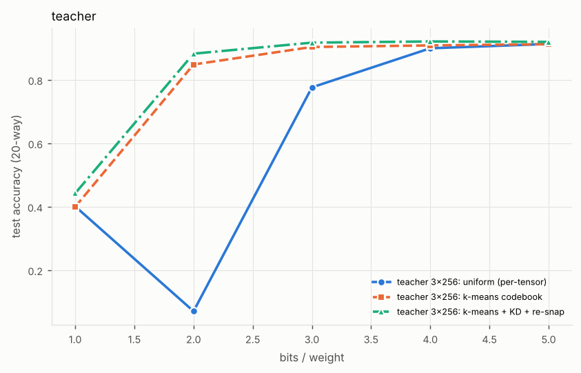

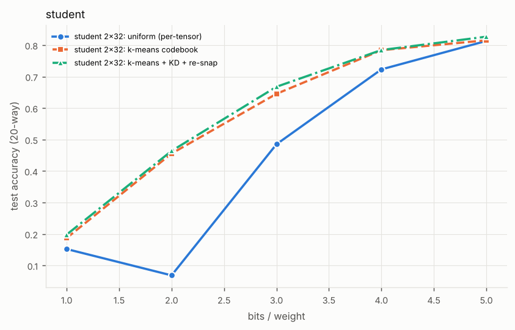

> Both schemes store b bits per weight: k-means has k = 2^b levels per layer, symmetric uniform has 2^b - 1 (1 bit = sign x mean|w|, i.e. 2 levels).

table

| bits | model | method | acc | target_ap | nll | ece | kl_bayes | params | macs |
|---|---|---|---|---|---|---|---|---|---|
| 1 | teacher 3x256 | uniform (per-tensor) | 0.4013 | 0.6926 | 1.9499 | 0.2126 | 1.8698 | 140,052 | 139,264 |
| 1 | teacher 3x256 | k-means codebook | 0.3999 | 0.7129 | 1.8405 | 0.1186 | 1.7585 | 140,052 | 139,264 |
| 1 | teacher 3x256 | k-means + KD + re-snap | 0.4426 | 0.7309 | 1.7510 | 0.1085 | 1.6701 | 140,052 | 139,264 |
| 2 | teacher 3x256 | uniform (per-tensor) | 0.0707 | 0.1009 | 3.0212 | 0.0312 | 2.9371 | 3,616 | 2,828 |
| 2 | teacher 3x256 | k-means codebook | 0.8487 | 0.9787 | 0.5309 | 0.0689 | 0.4565 | 140,052 | 139,264 |
| 2 | teacher 3x256 | k-means + KD + re-snap | 0.8828 | 0.9837 | 0.3606 | 0.0145 | 0.2806 | 140,052 | 139,264 |
| 3 | teacher 3x256 | uniform (per-tensor) | 0.7766 | 0.9611 | 1.2248 | 0.1587 | 1.1534 | 60,345 | 59,557 |
| 3 | teacher 3x256 | k-means codebook | 0.9039 | 0.9829 | 0.4037 | 0.0558 | 0.3295 | 140,052 | 139,264 |
| 3 | teacher 3x256 | k-means + KD + re-snap | 0.9176 | 0.9882 | 0.2779 | 0.0281 | 0.1993 | 140,052 | 139,264 |
| 4 | teacher 3x256 | uniform (per-tensor) | 0.8998 | 0.9850 | 0.4660 | 0.0676 | 0.3914 | 102,817 | 102,029 |
| 4 | teacher 3x256 | k-means codebook | 0.9088 | 0.9870 | 0.4009 | 0.0573 | 0.3283 | 140,052 | 139,264 |
| 4 | teacher 3x256 | k-means + KD + re-snap | 0.9213 | 0.9881 | 0.2777 | 0.0282 | 0.2002 | 140,052 | 139,264 |
| 5 | teacher 3x256 | uniform (per-tensor) | 0.9134 | 0.9883 | 0.3903 | 0.0543 | 0.3166 | 122,323 | 121,535 |
| 5 | teacher 3x256 | k-means codebook | 0.9129 | 0.9881 | 0.3913 | 0.0555 | 0.3161 | 140,052 | 139,264 |
| 5 | teacher 3x256 | k-means + KD + re-snap | 0.9200 | 0.9896 | 0.2881 | 0.0355 | 0.2083 | 140,052 | 139,264 |
| 1 | student 2x32 | uniform (per-tensor) | 0.1522 | 0.5368 | 4.6970 | 0.4733 | 4.6153 | 2,132 | 2,048 |
| 1 | student 2x32 | k-means codebook | 0.1872 | 0.2894 | 4.4196 | 0.4441 | 4.3403 | 2,132 | 2,048 |
| 1 | student 2x32 | k-means + KD + re-snap | 0.1981 | 0.2744 | 4.2842 | 0.4370 | 4.2042 | 2,132 | 2,048 |
| 2 | student 2x32 | uniform (per-tensor) | 0.0686 | 0.0429 | 9.2120 | 0.6760 | 9.1273 | 285 | 201 |
| 2 | student 2x32 | k-means codebook | 0.4555 | 0.7140 | 2.3504 | 0.2776 | 2.2729 | 2,132 | 2,048 |
| 2 | student 2x32 | k-means + KD + re-snap | 0.4639 | 0.7352 | 2.3306 | 0.2827 | 2.2538 | 2,132 | 2,048 |
| 3 | student 2x32 | uniform (per-tensor) | 0.4851 | 0.8212 | 2.1926 | 0.2911 | 2.1137 | 1,267 | 1,183 |
| 3 | student 2x32 | k-means codebook | 0.6453 | 0.8458 | 1.1510 | 0.1152 | 1.0706 | 2,132 | 2,048 |
| 3 | student 2x32 | k-means + KD + re-snap | 0.6677 | 0.8607 | 1.0923 | 0.1124 | 1.0131 | 2,132 | 2,048 |
| 4 | student 2x32 | uniform (per-tensor) | 0.7229 | 0.8929 | 0.8554 | 0.0654 | 0.7756 | 1,725 | 1,641 |
| 4 | student 2x32 | k-means codebook | 0.7839 | 0.9477 | 0.6514 | 0.0182 | 0.5732 | 2,132 | 2,048 |
| 4 | student 2x32 | k-means + KD + re-snap | 0.7844 | 0.9479 | 0.6517 | 0.0362 | 0.5746 | 2,132 | 2,048 |
| 5 | student 2x32 | uniform (per-tensor) | 0.8132 | 0.9495 | 0.5677 | 0.0100 | 0.4938 | 1,950 | 1,866 |
| 5 | student 2x32 | k-means codebook | 0.8153 | 0.9513 | 0.5597 | 0.0103 | 0.4820 | 2,132 | 2,048 |
| 5 | student 2x32 | k-means + KD + re-snap | 0.8268 | 0.9557 | 0.5272 | 0.0123 | 0.4495 | 2,132 | 2,048 |

38s

## 5 · Making small models better

### Bag of tricks for a small model  (`small_tricks`)

*Fixed small architecture. What actually moves its accuracy: regularizers, longer training, weight averaging, over-parameterize-then-collapse, self-distillation, a teacher, or train-big-then-shrink?*

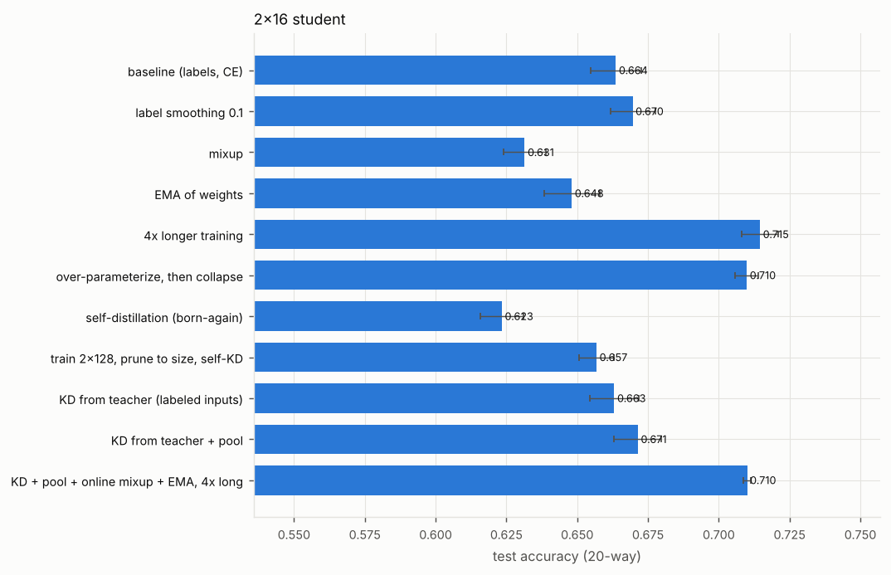

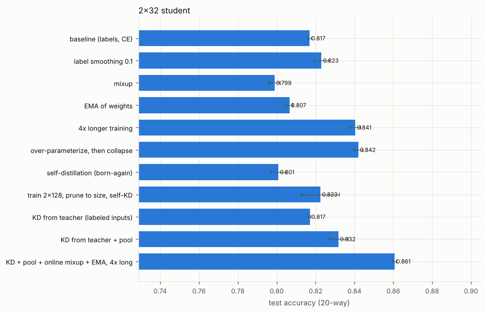

table

| method | student | acc | target_ap | fidelity | nll | ece | kl_bayes | params | macs |
|---|---|---|---|---|---|---|---|---|---|
| baseline (labels, CE) | 16x16 | 0.6637 ± 0.009 | 0.8432 ± 0.005 | 0.6741 ± 0.010 | 1.0180 ± 0.027 | 0.0146 ± 0.001 | 0.9359 ± 0.028 | 820 | 768 |
| label smoothing 0.1 | 16x16 | 0.6696 ± 0.008 | 0.8411 ± 0.007 | 0.6789 ± 0.008 | 1.0821 ± 0.021 | 0.1417 ± 0.005 | 0.9987 ± 0.021 | 820 | 768 |
| mixup | 16x16 | 0.6315 ± 0.007 | 0.8377 ± 0.013 | 0.6447 ± 0.008 | 1.2020 ± 0.024 | 0.1477 ± 0.003 | 1.1177 ± 0.024 | 820 | 768 |
| EMA of weights | 16x16 | 0.6481 ± 0.010 | 0.8378 ± 0.006 | 0.6590 ± 0.010 | 1.0598 ± 0.030 | 0.0397 ± 0.002 | 0.9776 ± 0.032 | 820 | 768 |
| 4x longer training | 16x16 | 0.7146 ± 0.006 | 0.8796 ± 0.011 | 0.7250 ± 0.005 | 0.8734 ± 0.028 | 0.0213 ± 0.001 | 0.7922 ± 0.029 | 820 | 768 |
| over-parameterize, then collapse | 16x16 | 0.7099 ± 0.004 | 0.9034 ± 0.006 | 0.7183 ± 0.004 | 0.8836 ± 0.009 | 0.0259 ± 0.002 | 0.8061 ± 0.008 | 820 | 768 |
| self-distillation (born-again) | 16x16 | 0.6234 ± 0.007 | 0.8426 ± 0.011 | 0.6367 ± 0.009 | 1.1083 ± 0.010 | 0.0210 ± 0.004 | 1.0246 ± 0.011 | 820 | 768 |
| train 2x128, prune to size, self-KD | 16x16 | 0.6568 ± 0.006 | 0.8477 ± 0.022 | 0.6711 ± 0.008 | 1.0139 ± 0.018 | 0.0128 ± 0.002 | 0.9308 ± 0.015 | 820 | 768 |
| KD from teacher (labeled inputs) | 16x16 | 0.6631 ± 0.009 | 0.8443 ± 0.005 | 0.6740 ± 0.010 | 1.0178 ± 0.028 | 0.0144 ± 0.001 | 0.9357 ± 0.029 | 820 | 768 |
| KD from teacher + pool | 16x16 | 0.6714 ± 0.008 | 0.8619 ± 0.002 | 0.6838 ± 0.006 | 0.9909 ± 0.023 | 0.0190 ± 0.009 | 0.9093 ± 0.023 | 820 | 768 |
| KD + pool + online mixup + EMA, 4x long | 16x16 | 0.7100 ± 0.001 | 0.8804 ± 0.028 | 0.7248 ± 0.002 | 0.8634 ± 0.014 | 0.0115 ± 0.002 | 0.7801 ± 0.012 | 820 | 768 |
| baseline (labels, CE) | 32x32 | 0.8170 ± 0.001 | 0.9524 ± 0.005 | 0.8309 ± 0.003 | 0.5538 ± 0.008 | 0.0092 ± 0.001 | 0.4758 ± 0.008 | 2,132 | 2,048 |
| label smoothing 0.1 | 32x32 | 0.8230 ± 0.004 | 0.9545 ± 0.002 | 0.8316 ± 0.006 | 0.6643 ± 0.013 | 0.1593 ± 0.002 | 0.5825 ± 0.013 | 2,132 | 2,048 |
| mixup | 32x32 | 0.7989 ± 0.003 | 0.9435 ± 0.007 | 0.8103 ± 0.002 | 0.7544 ± 0.007 | 0.1803 ± 0.005 | 0.6719 ± 0.008 | 2,132 | 2,048 |
| EMA of weights | 32x32 | 0.8065 ± 0.002 | 0.9477 ± 0.005 | 0.8206 ± 0.004 | 0.5849 ± 0.010 | 0.0227 ± 0.003 | 0.5055 ± 0.010 | 2,132 | 2,048 |
| 4x longer training | 32x32 | 0.8405 ± 0.003 | 0.9650 ± 0.002 | 0.8516 ± 0.000 | 0.5484 ± 0.010 | 0.0605 ± 0.003 | 0.4714 ± 0.008 | 2,132 | 2,048 |
| over-parameterize, then collapse | 32x32 | 0.8420 ± 0.002 | 0.9643 ± 0.004 | 0.8554 ± 0.001 | 0.5753 ± 0.018 | 0.0698 ± 0.005 | 0.5025 ± 0.015 | 2,132 | 2,048 |
| self-distillation (born-again) | 32x32 | 0.8008 ± 0.004 | 0.9392 ± 0.006 | 0.8151 ± 0.003 | 0.5947 ± 0.009 | 0.0155 ± 0.002 | 0.5136 ± 0.007 | 2,132 | 2,048 |
| train 2x128, prune to size, self-KD | 32x32 | 0.8225 ± 0.010 | 0.9485 ± 0.004 | 0.8348 ± 0.010 | 0.5435 ± 0.024 | 0.0117 ± 0.002 | 0.4662 ± 0.022 | 2,132 | 2,048 |
| KD from teacher (labeled inputs) | 32x32 | 0.8171 ± 0.001 | 0.9518 ± 0.005 | 0.8312 ± 0.003 | 0.5536 ± 0.009 | 0.0105 ± 0.001 | 0.4754 ± 0.009 | 2,132 | 2,048 |
| KD from teacher + pool | 32x32 | 0.8318 ± 0.005 | 0.9544 ± 0.005 | 0.8454 ± 0.005 | 0.5112 ± 0.013 | 0.0131 ± 0.003 | 0.4329 ± 0.015 | 2,132 | 2,048 |
| KD + pool + online mixup + EMA, 4x long | 32x32 | 0.8607 ± 0.001 | 0.9721 ± 0.005 | 0.8844 ± 0.002 | 0.4202 ± 0.007 | 0.0119 ± 0.002 | 0.3407 ± 0.007 | 2,132 | 2,048 |

267s

### Train big, then compress  (`train_big_then_compress`)

*To end up with a 2xW network, is it better to train 2xW directly or to train something much wider and prune down to 2xW? (Li et al. 2020)*

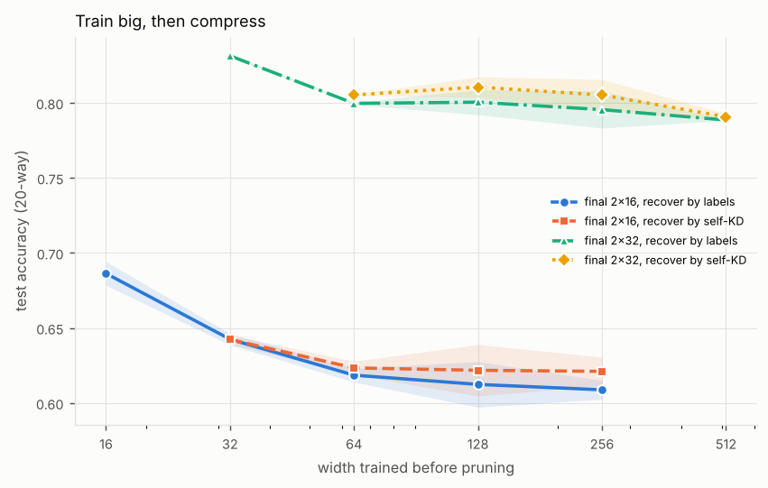

table

| start_width | target | method | acc | target_ap | nll | ece | kl_bayes | params | macs |
|---|---|---|---|---|---|---|---|---|---|
| 16 | final 2x16 | labels | 0.6863 ± 0.008 | 0.8536 ± 0.010 | 0.9445 ± 0.015 | 0.0116 ± 0.001 | 0.8621 ± 0.015 | 820 | 768 |
| 32 | final 2x16 | labels | 0.6425 ± 0.004 | 0.8601 ± 0.015 | 1.0558 ± 0.025 | 0.0184 ± 0.006 | 0.9727 ± 0.026 | 820 | 768 |
| 32 | final 2x16 | self-KD | 0.6423 ± 0.003 | 0.8572 ± 0.013 | 1.0584 ± 0.020 | 0.0267 ± 0.008 | 0.9754 ± 0.020 | 820 | 768 |
| 64 | final 2x16 | labels | 0.6185 ± 0.005 | 0.8233 ± 0.013 | 1.1290 ± 0.018 | 0.0193 ± 0.001 | 1.0465 ± 0.017 | 820 | 768 |
| 64 | final 2x16 | self-KD | 0.6234 ± 0.004 | 0.8349 ± 0.015 | 1.1044 ± 0.017 | 0.0225 ± 0.002 | 1.0220 ± 0.016 | 820 | 768 |
| 128 | final 2x16 | labels | 0.6124 ± 0.015 | 0.8064 ± 0.012 | 1.1514 ± 0.037 | 0.0199 ± 0.002 | 1.0688 ± 0.035 | 820 | 768 |
| 128 | final 2x16 | self-KD | 0.6218 ± 0.017 | 0.8135 ± 0.019 | 1.1343 ± 0.044 | 0.0292 ± 0.004 | 1.0518 ± 0.042 | 820 | 768 |
| 256 | final 2x16 | labels | 0.6088 ± 0.006 | 0.8275 ± 0.030 | 1.1520 ± 0.023 | 0.0245 ± 0.003 | 1.0688 ± 0.022 | 820 | 768 |
| 256 | final 2x16 | self-KD | 0.6211 ± 0.010 | 0.8375 ± 0.017 | 1.1260 ± 0.019 | 0.0301 ± 0.003 | 1.0435 ± 0.019 | 820 | 768 |
| 32 | final 2x32 | labels | 0.8314 ± 0.001 | 0.9582 ± 0.002 | 0.5205 ± 0.005 | 0.0190 ± 0.003 | 0.4434 ± 0.005 | 2,132 | 2,048 |
| 64 | final 2x32 | labels | 0.7996 ± 0.001 | 0.9431 ± 0.012 | 0.6052 ± 0.000 | 0.0124 ± 0.002 | 0.5238 ± 0.001 | 2,132 | 2,048 |
| 64 | final 2x32 | self-KD | 0.8053 ± 0.000 | 0.9468 ± 0.010 | 0.5881 ± 0.001 | 0.0219 ± 0.001 | 0.5075 ± 0.001 | 2,132 | 2,048 |
| 128 | final 2x32 | labels | 0.8004 ± 0.008 | 0.9384 ± 0.006 | 0.6136 ± 0.018 | 0.0244 ± 0.005 | 0.5369 ± 0.016 | 2,132 | 2,048 |
| 128 | final 2x32 | self-KD | 0.8105 ± 0.007 | 0.9452 ± 0.005 | 0.5871 ± 0.016 | 0.0312 ± 0.004 | 0.5099 ± 0.015 | 2,132 | 2,048 |
| 256 | final 2x32 | labels | 0.7955 ± 0.012 | 0.9170 ± 0.013 | 0.6236 ± 0.028 | 0.0262 ± 0.004 | 0.5426 ± 0.023 | 2,132 | 2,048 |
| 256 | final 2x32 | self-KD | 0.8053 ± 0.010 | 0.9369 ± 0.006 | 0.5920 ± 0.022 | 0.0306 ± 0.002 | 0.5123 ± 0.017 | 2,132 | 2,048 |
| 512 | final 2x32 | labels | 0.7886 ± 0.000 | 0.9349 ± 0.002 | 0.6449 ± 0.003 | 0.0275 ± 0.001 | 0.5627 ± 0.004 | 2,132 | 2,048 |
| 512 | final 2x32 | self-KD | 0.7907 ± 0.002 | 0.9397 ± 0.000 | 0.6319 ± 0.002 | 0.0317 ± 0.002 | 0.5500 ± 0.003 | 2,132 | 2,048 |

99s

## 6 · Specialization (the bird-detector question)

### Recovery data for a specialist: are bird images enough?  (`specialist_data`)

*The YOLOv8n cockpit's recovery set is 400 images that *all contain birds*. If the recovery data only shows positives, can the model still learn what is NOT a bird?*

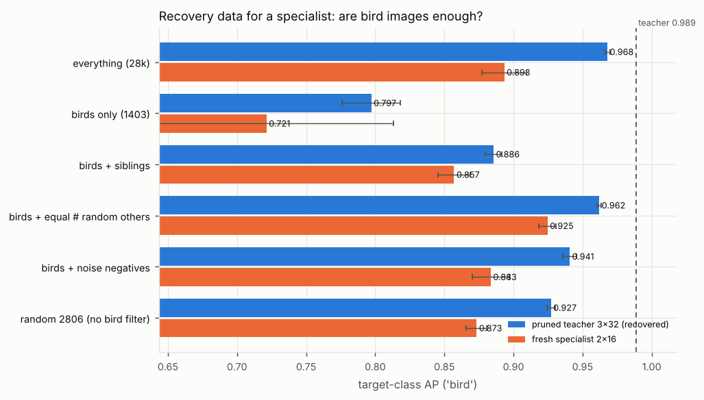

table

| model | data | target_ap | params | macs |
|---|---|---|---|---|
| pruned teacher 3x32 (recovered) | everything (28k) | 0.9679 ± 0.002 | 2,792 | 2,688 |
| fresh specialist 2x16 | everything (28k) | 0.8933 ± 0.016 | 616 | 576 |
| pruned teacher 3x32 (recovered) | birds only (1403) | 0.7971 ± 0.021 | 2,792 | 2,688 |
| fresh specialist 2x16 | birds only (1403) | 0.7213 ± 0.092 | 616 | 576 |
| pruned teacher 3x32 (recovered) | birds + siblings | 0.8856 ± 0.006 | 2,792 | 2,688 |
| fresh specialist 2x16 | birds + siblings | 0.8571 ± 0.011 | 616 | 576 |
| pruned teacher 3x32 (recovered) | birds + equal # random others | 0.9620 ± 0.001 | 2,792 | 2,688 |
| fresh specialist 2x16 | birds + equal # random others | 0.9246 ± 0.006 | 616 | 576 |
| pruned teacher 3x32 (recovered) | birds + noise negatives | 0.9406 ± 0.005 | 2,792 | 2,688 |
| fresh specialist 2x16 | birds + noise negatives | 0.8835 ± 0.013 | 616 | 576 |
| pruned teacher 3x32 (recovered) | random 2806 (no bird filter) | 0.9271 ± 0.003 | 2,792 | 2,688 |
| fresh specialist 2x16 | random 2806 (no bird filter) | 0.8733 ± 0.007 | 616 | 576 |

30s

### Carving a specialist out of the generalist  (`specialist_prune`)

*Prune the teacher's neurons for one class. Does a task-aware importance score (bird-vs-rest) keep a better bird detector than an all-class score, and does collapsing the head help recovery?*

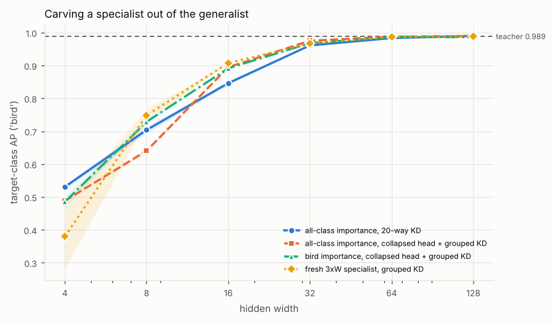

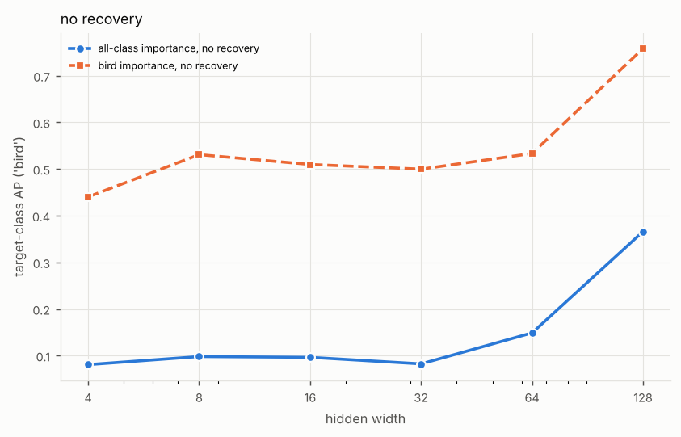

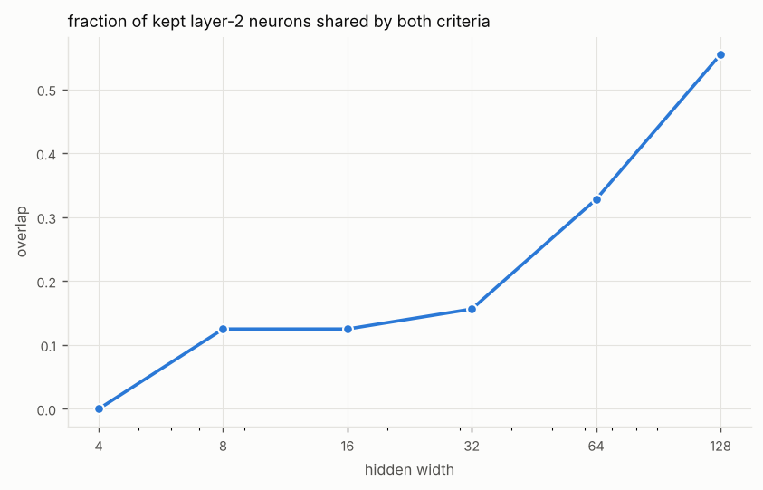

table

| method | width | acc | target_ap | nll | ece | kl_bayes | params | macs | overlap |
|---|---|---|---|---|---|---|---|---|---|
| all-class importance, no recovery | 128 | 0.2994 | 0.3660 | 3.8637 | 0.4337 | 3.7839 | 37,268 | 36,864 |  |
| bird importance, no recovery | 128 | 0.1651 | 0.7581 | 8.4751 | 0.6606 | 8.3935 | 37,268 | 36,864 |  |
| all-class importance, 20-way KD | 128 | 0.9154 ± 0.000 | 0.9901 ± 0.000 | 0.3132 ± 0.001 | 0.0428 ± 0.000 | 0.2324 ± 0.001 | 37,268 | 36,864 |  |
| all-class importance, collapsed head + grouped KD | 128 |  | 0.9900 ± 0.000 |  |  |  | 35,720 | 35,328 |  |
| bird importance, collapsed head + grouped KD | 128 |  | 0.9864 ± 0.000 |  |  |  | 35,720 | 35,328 |  |
| fresh 3xW specialist, grouped KD | 128 |  | 0.9889 ± 0.002 |  |  |  | 35,720 | 35,328 |  |
| all-class importance, no recovery | 64 | 0.1519 | 0.1487 | 3.3144 | 0.2005 | 3.2330 | 10,452 | 10,240 |  |
| bird importance, no recovery | 64 | 0.0708 | 0.5333 | 5.9985 | 0.6715 | 5.9177 | 10,452 | 10,240 |  |
| all-class importance, 20-way KD | 64 | 0.9025 ± 0.000 | 0.9834 ± 0.000 | 0.3121 ± 0.000 | 0.0282 ± 0.001 | 0.2350 ± 0.000 | 10,452 | 10,240 |  |
| all-class importance, collapsed head + grouped KD | 64 |  | 0.9879 ± 0.001 |  |  |  | 9,672 | 9,472 |  |
| bird importance, collapsed head + grouped KD | 64 |  | 0.9862 ± 0.001 |  |  |  | 9,672 | 9,472 |  |
| fresh 3xW specialist, grouped KD | 64 |  | 0.9873 ± 0.000 |  |  |  | 9,672 | 9,472 |  |
| all-class importance, no recovery | 32 | 0.1104 | 0.0823 | 2.9917 | 0.0100 | 2.9079 | 3,188 | 3,072 |  |
| bird importance, no recovery | 32 | 0.0711 | 0.4997 | 3.3085 | 0.2598 | 3.2260 | 3,188 | 3,072 |  |
| all-class importance, 20-way KD | 32 | 0.8360 ± 0.002 | 0.9611 ± 0.000 | 0.5042 ± 0.003 | 0.0095 ± 0.000 | 0.4251 ± 0.003 | 3,188 | 3,072 |  |
| all-class importance, collapsed head + grouped KD | 32 |  | 0.9755 ± 0.001 |  |  |  | 2,792 | 2,688 |  |
| bird importance, collapsed head + grouped KD | 32 |  | 0.9679 ± 0.002 |  |  |  | 2,792 | 2,688 |  |
| fresh 3xW specialist, grouped KD | 32 |  | 0.9667 ± 0.000 |  |  |  | 2,792 | 2,688 |  |
| all-class importance, no recovery | 16 | 0.0441 | 0.0963 | 3.0334 | 0.0437 | 2.9488 | 1,092 | 1,024 |  |
| bird importance, no recovery | 16 | 0.0784 | 0.5097 | 2.9369 | 0.0495 | 2.8530 | 1,092 | 1,024 |  |
| all-class importance, 20-way KD | 16 | 0.6579 ± 0.009 | 0.8464 ± 0.006 | 1.0201 ± 0.026 | 0.0205 ± 0.003 | 0.9381 ± 0.025 | 1,092 | 1,024 |  |
| all-class importance, collapsed head + grouped KD | 16 |  | 0.8950 ± 0.001 |  |  |  | 888 | 832 |  |
| bird importance, collapsed head + grouped KD | 16 |  | 0.8916 ± 0.001 |  |  |  | 888 | 832 |  |
| fresh 3xW specialist, grouped KD | 16 |  | 0.9079 ± 0.000 |  |  |  | 888 | 832 |  |
| all-class importance, no recovery | 8 | 0.0677 | 0.0980 | 3.0135 | 0.0061 | 2.9289 | 428 | 384 |  |
| bird importance, no recovery | 8 | 0.0773 | 0.5308 | 2.9710 | 0.0326 | 2.8866 | 428 | 384 |  |
| all-class importance, 20-way KD | 8 | 0.4628 ± 0.009 | 0.7040 ± 0.010 | 1.6135 ± 0.023 | 0.0229 ± 0.003 | 1.5266 ± 0.022 | 428 | 384 |  |
| all-class importance, collapsed head + grouped KD | 8 |  | 0.6406 ± 0.007 |  |  |  | 320 | 288 |  |
| bird importance, collapsed head + grouped KD | 8 |  | 0.7289 ± 0.005 |  |  |  | 320 | 288 |  |
| fresh 3xW specialist, grouped KD | 8 |  | 0.7485 ± 0.018 |  |  |  | 320 | 288 |  |
| all-class importance, no recovery | 4 | 0.0540 | 0.0807 | 2.9986 | 0.0063 | 2.9138 | 192 | 160 |  |
| bird importance, no recovery | 4 | 0.0627 | 0.4403 | 2.9884 | 0.0045 | 2.9037 | 192 | 160 |  |
| all-class importance, 20-way KD | 4 | 0.3193 ± 0.001 | 0.5308 ± 0.008 | 2.0297 ± 0.007 | 0.0180 ± 0.003 | 1.9428 ± 0.007 | 192 | 160 |  |
| all-class importance, collapsed head + grouped KD | 4 |  | 0.4885 ± 0.000 |  |  |  | 132 | 112 |  |
| bird importance, collapsed head + grouped KD | 4 |  | 0.4850 ± 0.017 |  |  |  | 132 | 112 |  |
| fresh 3xW specialist, grouped KD | 4 |  | 0.3796 ± 0.098 |  |  |  | 132 | 112 |  |
|  | 128 |  |  |  |  |  |  |  | 0.5547 |
|  | 64 |  |  |  |  |  |  |  | 0.3281 |
|  | 32 |  |  |  |  |  |  |  | 0.1562 |
|  | 16 |  |  |  |  |  |  |  | 0.1250 |
|  | 8 |  |  |  |  |  |  |  | 0.1250 |
|  | 4 |  |  |  |  |  |  |  | 0.0000 |

90s

### How small can a one-class specialist be?  (`specialist_size`)

*Target-class AP vs. size for a 20-way generalist student and for specialists whose heads keep less and less of the teacher's label space.*

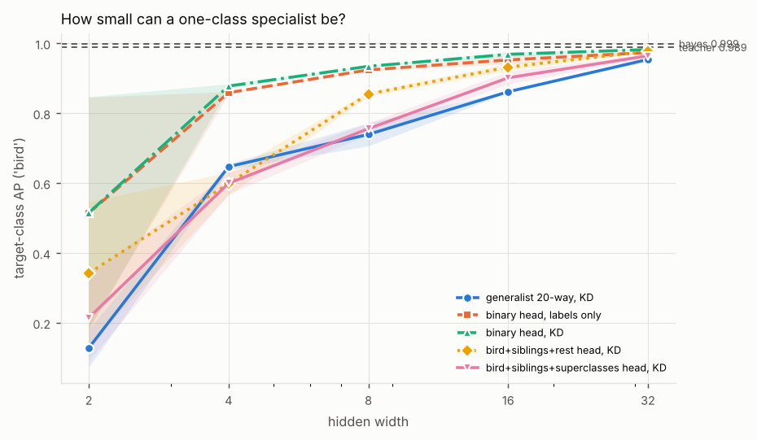

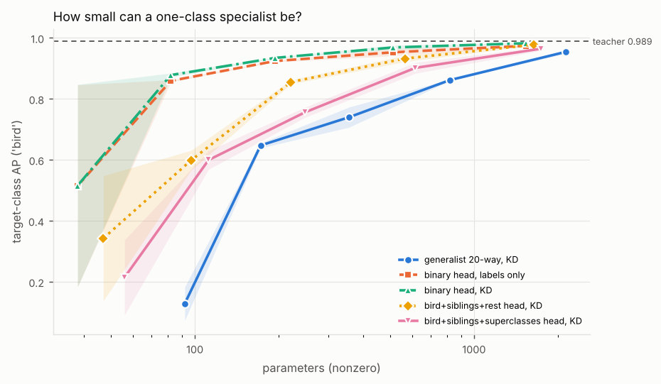

table

| method | width | acc | target_ap | nll | ece | kl_bayes | params | macs |
|---|---|---|---|---|---|---|---|---|
| generalist 20-way, KD | 2 | 0.1227 ± 0.050 | 0.1286 ± 0.055 | 2.7392 ± 0.182 | 0.0222 ± 0.017 | 2.6535 ± 0.182 | 92 | 68 |
| binary head, labels only | 2 |  | 0.5149 ± 0.331 |  |  |  | 38 | 32 |
| binary head, KD | 2 |  | 0.5156 ± 0.332 |  |  |  | 38 | 32 |
| bird+siblings+rest head, KD | 2 |  | 0.3428 ± 0.205 |  |  |  | 47 | 38 |
| bird+siblings+superclasses head, KD | 2 |  | 0.2149 ± 0.123 |  |  |  | 56 | 44 |
| generalist 20-way, KD | 4 | 0.3240 ± 0.012 | 0.6475 ± 0.008 | 1.9887 ± 0.040 | 0.0219 ± 0.007 | 1.9041 ± 0.040 | 172 | 144 |
| binary head, labels only | 4 |  | 0.8592 ± 0.003 |  |  |  | 82 | 72 |
| binary head, KD | 4 |  | 0.8781 ± 0.007 |  |  |  | 82 | 72 |
| bird+siblings+rest head, KD | 4 |  | 0.5989 ± 0.032 |  |  |  | 97 | 84 |
| bird+siblings+superclasses head, KD | 4 |  | 0.5998 ± 0.031 |  |  |  | 112 | 96 |
| generalist 20-way, KD | 8 | 0.4556 ± 0.015 | 0.7397 ± 0.033 | 1.6033 ± 0.028 | 0.0156 ± 0.004 | 1.5192 ± 0.029 | 356 | 320 |
| binary head, labels only | 8 |  | 0.9243 ± 0.003 |  |  |  | 194 | 176 |
| binary head, KD | 8 |  | 0.9346 ± 0.002 |  |  |  | 194 | 176 |
| bird+siblings+rest head, KD | 8 |  | 0.8555 ± 0.006 |  |  |  | 221 | 200 |
| bird+siblings+superclasses head, KD | 8 |  | 0.7561 ± 0.017 |  |  |  | 248 | 224 |
| generalist 20-way, KD | 16 | 0.6714 ± 0.008 | 0.8619 ± 0.002 | 0.9909 ± 0.023 | 0.0190 ± 0.009 | 0.9093 ± 0.023 | 820 | 768 |
| binary head, labels only | 16 |  | 0.9530 ± 0.012 |  |  |  | 514 | 480 |
| binary head, KD | 16 |  | 0.9689 ± 0.007 |  |  |  | 514 | 480 |
| bird+siblings+rest head, KD | 16 |  | 0.9324 ± 0.010 |  |  |  | 565 | 528 |
| bird+siblings+superclasses head, KD | 16 |  | 0.9018 ± 0.018 |  |  |  | 616 | 576 |
| generalist 20-way, KD | 32 | 0.8318 ± 0.005 | 0.9544 ± 0.005 | 0.5112 ± 0.013 | 0.0131 ± 0.003 | 0.4329 ± 0.015 | 2,132 | 2,048 |
| binary head, labels only | 32 |  | 0.9743 ± 0.003 |  |  |  | 1,538 | 1,472 |
| binary head, KD | 32 |  | 0.9827 ± 0.002 |  |  |  | 1,538 | 1,472 |
| bird+siblings+rest head, KD | 32 |  | 0.9779 ± 0.002 |  |  |  | 1,637 | 1,568 |
| bird+siblings+superclasses head, KD | 32 |  | 0.9648 ± 0.006 |  |  |  | 1,736 | 1,664 |

83s
